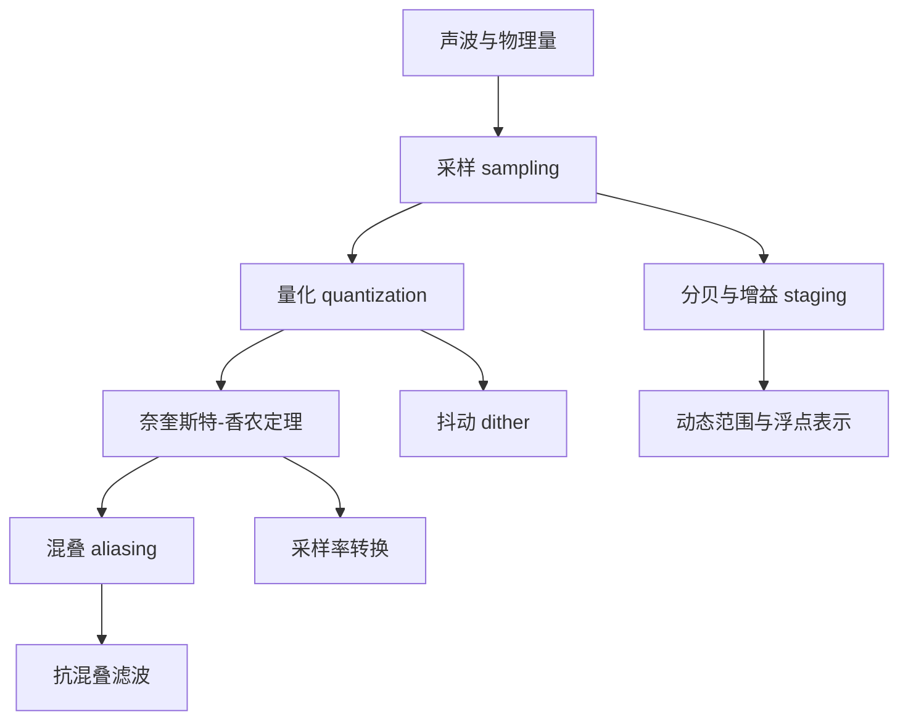

# MOC - Audio Fundamentals

> [!important] 为什么制作人反而要重学这一层
> 你调了十年 EQ，但你可能从没算过"6 dB 到底是多少倍"。
> 制作人的知识是**操作性的**（这样转听起来好），工程师的知识是**量化的**（这个系数对应什么极点）。
> 这个库要把前者翻译成后者——**这是你相对纯 CS 背景的人最大的优势，别浪费**。

## 这个领域解决什么

把"声音"变成"数字"，再把"数字"变回"声音"，并保证这个过程中不丢失信息、不引入伪影。
所有后续的 DSP 都在这个框架里工作。

## 依赖顺序

## 主题

### 🔴 必学（地基）

- [[声波与物理量]] — 频率、振幅、相位、声压级，以及它们如何对应到电压和数字
- [[采样与量化]] — 把连续信号变成离散序列到底做了什么
- [[奈奎斯特-香农定理]] — 为什么 44.1kHz 能表示 22.05kHz；定理的**前提条件**常被忽略
- [[混叠 aliasing]] — 插件里最常见的"金属味/刺耳感"的来源
- [[抗混叠滤波]] — 输入和输出两端都要做
- [[分贝与增益 staging]] — dBFS / dBu / dBSPL 的区别，以及为什么插件内部不该用 dB
- [[浮点音频表示]] — float vs double、-1..1 归一化、为什么不用定点

### 🟠 常用

- [[采样率的选择]] — 44.1 / 48 / 88.2 / 96 / 192 kHz 的实际取舍
- [[抖动 dither]] — 位深转换时的量化误差处理，以及它为什么"听起来更好"
- [[采样率转换 resampling]] — 同步 vs 异步、质量等级、实时约束
- [[位深与动态范围]] — 16/24/32-bit 的噪声底与实用含义
- [[音频缓冲区与 block size]] — 为什么 block size 会影响你的算法设计
- [[时钟与抖动 jitter]] — 数字时钟误差如何转化为可闻失真
- [[音频测量基础]] — THD、THD+N、SNR、动态范围、频率响应怎么测

### 🟢 进阶

- [[过采样 oversampling]] — 内部升采样做非线性处理再降回来（详见 [[MOC - DSP]]）
- [[多速率处理 multirate]] — 抽取与内插的滤波器组设计
- [[心理声学与采样率]] — 20kHz 以上到底有没有意义（详见 [[MOC - Music & Acoustics]]）
- [[定点 DSP 与嵌入式]] — 什么时候必须放弃浮点

## 制作人视角的翻译表

| 你熟悉的说法 | 工程上的对应 |
|---|---|
| "这个插件有数字味" | 可能是混叠、或者非线性处理没过采样 |
| "高频有点毛刺" | 可能是量化噪声、或者 zipper noise |
| "低频糊了" | 可能是相位问题、或者滤波器的群延迟 |
| "响度上不去" | 可能是 inter-sample peak，或者限制器设计 |
| "6 dB 衰减" | 幅度 ×0.5（电压），功率 ÷4 |
| "-inf 到 0 dB 的推子" | 线性增益 0 到 1，但听觉上不是线性的 |

> [!tip] 这张表是你的知识库最有价值的部分之一
> 每当你遇到"我听出来了但说不清是什么"的情况，就往这张表加一行。
> 加满 50 行的时候，你就有了别人没有的东西。
