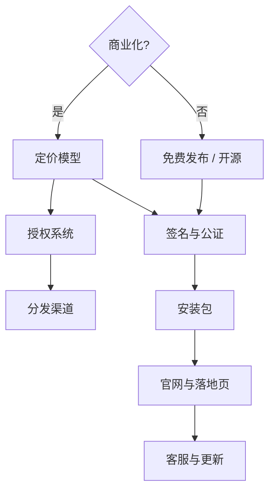

# MOC - Craft & Release

> [!note] 如果只是兴趣项目，整块可以跳过
> 但"发布"这件事有个副作用：**它会强迫你把插件做对**。
> 自己用的插件可以崩溃、可以只有 macOS 版、可以没有预设。
> 给别人用的不行。很多人的技术飞跃发生在第一次发布。

## 这个领域解决什么

从"我的机器上能跑"到"别人的机器上能用、愿意用、愿意付钱"。

## 决策顺序

## 主题

### 🔴 上线前必做

- [[代码签名与公证]] — macOS 不签名会直接被 Gatekeeper 拦下
- [[安装包制作]] — .pkg / .dmg / Inno Setup 的取舍
- [[插件兼容性测试矩阵]] — 至少测哪几个宿主、哪些版本
- [[插件验证工具]] — pluginval / auval / validator，发布前的自动化门禁
- [[版本号与更新机制]] — 语义化版本、更新通知、旧版兼容
- [[崩溃报告与遥测]] — 怎么知道用户的插件崩了（以及隐私边界）

### 🟠 商业化

- [[定价策略]] — 一次性买断 / 订阅 / 免费增值 / 按需付费
- [[分发渠道对比]] — 自己卖 / Plugin Boutique / Splice / Gumroad / KVR
- [[授权系统选型]] — 无授权 / 序列号 / 机器指纹 / iLok 的取舍
- [[防破解的现实]] — 破解是必然的；问题是怎么让正版体验更好
- [[税务与跨境收款]] — 个人开发者的实际障碍
- [[macOS 代码签名]] — 三步流程的第一步
- [[macOS 公证 (notarization)]] — 完整的 notarytool 参数与坑
- [[插件合规性测试：pluginval]] | ⚠️ 未安装，参数需核实
- [[Windows 代码签名]] — ⚠️ 置信度低，未实测
- [[插件扫描机制]] — 为什么插件不出现
- [[开源与商业的许可证陷阱]] — JUCE 双授权、VST3 已是 MIT、第三方库的 copyleft 风险
- [[竞品与市场调研]] — 怎么确认"这个插件已经有人做了"

### 🟢 长期

- [[用户支持流程]] — 邮件模板、常见问题、退款政策
- [[社区与营销]] — KVR / Reddit / YouTube 评测的实际效果
- [[插件品牌与视觉]] — 名字、Logo、界面风格的一致性
- [[数据分析]] — 什么指标真正有用（不是下载量）

## 一个残酷的现实

> [!warning] 做插件最难的不是 DSP
> 是**让人知道你做了插件**。
> 每年有数百个新插件发布，绝大多数零下载。
> 如果你要商业化，从第一天就要想"我的插件解决了什么别人没解决的问题"。
> 你的优势在于：**你是音乐人**，你知道音乐人真正的痛点——那些纯工程师根本意识不到的痛点。
