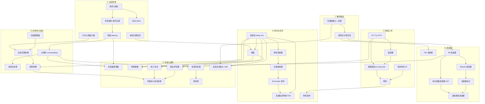

# 🧮 MOC - DSP（数字信号处理）

> 本页是**索引**，不是教程。它只回答两个问题：**「我现在该学什么」**和**「这个概念该放在哪」**。
> 下面大量链接指向还不存在的页面——这是**故意的**，它们就是待写队列。Obsidian 会把它们显示为未解析链接。

## ⭐ 已完成的核心页面（先看这些）

| 页面 | 一句话 |
|---|---|
| [[Biquad 滤波器]] | 音频里 90% 的滤波器，含系数公式与稳定性 |
| [[延迟线 delay line]] | 延迟/合唱/镶边/混响的共同骨架 |
| [[插值]] | 分数延迟；线性/Lagrange/全通的实测频响对比 |
| [[FFT 与 STFT]] | 验证一切 DSP 的工具；含分辨率与窗函数 |
| [[反馈延迟网络 FDN]] | 现代混响的主流结构；正交矩阵与能量守恒 |
| [[参数平滑 parameter smoothing]] | 最常见的爆音原因 |

## 这个领域解决什么问题

DSP 回答的是：**给我一串数字，怎么把它变成另一串听起来不一样的数字——而且我知道为什么。**

对插件开发者来说，它提供三样东西：

1. **描述能力** — 用传递函数（transfer function）和差分方程，把"这个效果器在做什么"写成可计算、可实现的形式。
2. **预测能力** — 在写第一行代码之前，就知道它会不会不稳定、会不会混叠、低频会不会糊、相位会不会毁掉瞬态。
3. **取舍能力** — 同一件事几乎总有多种算法。DSP 让你知道代价付在哪里：CPU、延迟、音质、相位、还是实现复杂度。

> [!important] 你的位置
> 你已经有"什么声音是对的"这个判断力——这是稀缺资产，纯 CS 背景的人没有。
> DSP 补的是另一半：把那个判断翻译成**可验证的数学和代码**。
> 所以下面每个条目最终都要落到"我能写出来，并且能测出它对不对"。

---

## 知识依赖顺序

箭头 = **「不先懂 A，B 就只能死记硬背」**。可以从任意一个 🔴 节点切入；如果卡住，顺着箭头往回退一层，缺的通常是那里的东西。



### 最小主线（如果只想先跑通一条路）

```
传递函数与 z 变换 → 极零点与稳定性 → Biquad 滤波器 → 延迟线 delay line → 插值
```

这条线走完，你已经能写出 EQ、delay、chorus，以及一个能用的算法混响骨架。**建议就从这里开始**，其余分支按需展开。

---

## ⭐ 对效果器开发者最重要的 5 个概念

> [!tip] 为什么是这 5 个
> 判据是「**不掌握它，你会写出听起来对但实际是坏的效果器**」。
> 这是判断，不是定论——随着你做的效果器类型变化，这个名单会变。

| # | 概念 | 不学它的后果 |
|---|---|---|
| 1 | [[传递函数与 z 变换]] + [[极零点与稳定性]] | 唯一能让你在写代码前判断"会不会爆"的工具。没有它，滤波器参数只能靠试 |
| 2 | [[Biquad 滤波器]] | 覆盖绝大多数 EQ 与音色滤波需求的最小单元。它也是理解所有 IIR 的入口 |
| 3 | [[延迟线 delay line]] + [[插值]] | delay / reverb / chorus / flanger / 物理建模的共同骨架。插值决定了分数延迟的音色 |
| 4 | [[过采样 oversampling]] | 只要碰非线性（饱和、失真、waveshaping），它就是必需品，不是优化项 |
| 5 | [[包络跟随器]] | 所有动态处理的传感器。压缩器做不好，九成问题出在这里，而不是增益计算 |

---

## 主题清单

难度用 ★ 表示（★=入门，★★★★★=需要静下心推导）；优先级用 🔴必学 / 🟠常用 / 🟢进阶。

### ① 采样与信号基础 — 🟠 常用 · 难度 ★★

> 这组是**前置知识**。它们和 [[MOC - Audio Fundamentals]] 有重叠——那边讲"物理与听感"，这边只讲"实现时必须知道的约束"。

- [[采样与量化]] — 离散化的两个动作：时间上取样、幅度上取整。后面一切的地基
- [[奈奎斯特-香农定理]] — 为什么采样率决定你能表示的最高频率，以及"带限"这个前提有多关键
- [[混叠 aliasing]] — 超带限分量折叠回可听频段的机制。所有抗混叠设计（过采样、BLEP、预滤波）都在对付它
- [[抖动 dither]] — 量化误差的去相关处理：用一点噪声换掉失真，以及它只在降位深时才有意义
- [[分贝与增益分级]] — dBFS / dBu / dBSPL 几种口径的区别，以及插件内部的增益结构怎么摆
- [[相位与群延迟]] — 相位响应怎么变成"瞬态被抹掉"的听感；滤波器相位失真的来源

### ② 频域工具 — 🟠 常用 · 难度 ★★★

- [[FFT 与 STFT]] — 从 DFT 到短时傅里叶变换。频域处理的入口，也是理解"分帧"这件事的地方
- [[窗函数]] — 频谱泄漏从哪来，矩形窗/汉宁/Blackman 各自的取舍
- [[重叠相加 overlap-add]] — 把逐块频域处理无缝拼回时域的标准方法，写 FFT 效果器必踩
- [[卷积]] — 时域卷积等于频域相乘；快速卷积为什么要分块，分块又引入什么
- [[脉冲响应 IR]] — 一个系统被脉冲激励后的完整输出。混响与音箱模拟的核心数据
- [[相位声码器]] — phase vocoder：靠 STFT 的相位推进做时间伸缩与移调，以及它特有的"金属味"从哪来

### ③ 滤波器 — 🔴 必学 · 难度 ★★★

- [[传递函数与 z 变换]] — H(z) 是滤波器唯一通用的描述方式；差分方程在频域的翻译
- [[极零点与稳定性]] — 看极点位置就能判断会不会发散。设计滤波器时的硬约束
- [[FIR 滤波器]] — 线性相位、绝对稳定，代价是阶数。适合做什么、不适合做什么
- [[IIR 滤波器]] — 用反馈换计算量，代价是相位非线性与稳定性风险
- [[Biquad 滤波器]] — 二阶 IIR，EQ 与滤波的通用积木。直接型与其他拓扑的数值差异值得单独看
- [[滤波器设计]] — Butterworth / Chebyshev / Linkwitz-Riley 等家族的取舍，以及 crossover 场景的特殊要求
- [[状态变量滤波器 SVF]] — 同时拿到 LP/BP/HP 三个输出，被调制时表现比 Biquad 好
- [[虚拟模拟滤波器]] — Moog ladder 与 zero-delay feedback 拓扑：为什么要解反馈方程而不是直接加单位延迟

### ④ 时间与空间 — 🔴 必学 · 难度 ★★★

- [[延迟线 delay line]] — 环形缓冲区加读写指针。几乎所有空间类与调制类效果器的骨架
- [[插值]] — 分数延迟的读写方式：线性 / 全通 / 样条，各自在音色与成本上的代价
- [[梳状滤波器]] — comb filter：延迟加反馈或前馈产生的周期性频响。混响与 flanger 的公共祖先
- [[全通滤波器]] — allpass：幅频不变、只改相位。混响里用来提高回声密度而不改变频谱
- [[Schroeder 混响]] — 梳状加全通串联的经典拓扑。理解混响结构的最佳起点
- [[反馈延迟网络 FDN]] — 多条延迟线交叉反馈。现代算法混响的主流骨架，难点在反馈矩阵
- [[卷积混响]] — 用真实 IR 做混响，以及分区卷积为什么在长 IR 下是必要的

### ⑤ 非线性与动态 — 🔴 必学 · 难度 ★★★

- [[非线性处理]] — waveshaping / 饱和 / 失真的数学形式，以及它们**必然**产生的谐波与混叠
- [[过采样 oversampling]] — 把非线性产生的超带限分量推到带外再滤掉。倍率与抗混叠滤波器的取舍
- [[动态范围处理]] — 压缩器 / 限制器 / 扩展器的共同结构：检测器、增益计算、增益平滑
- [[包络跟随器]] — envelope follower：怎么把波形变成控制信号，峰值检测 vs RMS，attack/release 的时域行为
- [[侧链与前瞻 lookahead]] — 外部触发源与提前量，以及前瞻**必然**引入的延迟与延迟补偿
- [[软膝 soft knee]] — 拐点处的平滑过渡，以及它和增益曲线计算的关系

### ⑥ 调制、音高与粒子 — 🟠 常用 · 难度 ★★★

- [[调制效果]] — chorus / flanger / phaser 的拓扑差异，以及为什么它们听起来完全不同
- [[共振峰与音高变换]] — 变调时如何不把共振峰一起搬走（搬走了会变成什么效果）
- [[粒子合成 granular synthesis]] — 用短窗重叠拼接重建声音。粒度、密度、散布这几个参数到底在控制什么

### ⑦ 合成与物理建模 — 🟢 进阶 · 难度 ★★★★

- [[抗混叠振荡器]] — BLIT / BLEP / DPW / PolyBLEP 各自的思路与适用波形
- [[物理建模]] — Karplus-Strong 与数字波导：用延迟线加滤波模拟振动体

### ⑧ 进阶数学与自适应 — 🟢 进阶 · 难度 ★★★★

- [[多速率处理]] — multirate：分频段处理与采样率转换的系统级视角；滤波器组与完美重构
- [[重采样 resampling]] — 采样率转换的具体实现，以及质量与成本的权衡点在哪
- [[自适应滤波 LMS 与 RLS]] — 用误差反馈自动调整滤波器系数。主动降噪、系统辨识、自适应 EQ 的基础

---

> [!note] 关于本页的 `sources: []`
> MOC 是索引，它声明的是**结构与范围**，不是事实性结论，所以不带来源。
> 但由它指向的**每一个主题页都必须遵守溯源规则**（见 [[AGENTS]] §3）——公认常识免标注，其余要来源或 `> [!warning] 未验证`。

> [!warning] 未验证：本页的优先级与难度评级
> 🔴/🟠/🟢 和 ★ 的数量是**基于常见插件开发路径的判断**，不是从资料推导出的结论。
> 如果你实际做下来发现某个"进阶"条目其实是日常必需，直接改，不用犹豫。

> [!note] 与相邻 MOC 的边界
> - 采样、量化、奈奎斯特、dB、相位 → 物理与听感部分在 [[MOC - Audio Fundamentals]]，实现约束在本页 ①
> - 滤波器与延迟线的**实时实现**（SIMD、无锁、denormal）→ [[MOC - Realtime Engineering]]
> - 振荡器与滤波器的**音乐性用法** → [[MOC - Music & Acoustics]]

## 相关

- [[MOC - Audio Fundamentals]] — 前置：物理、听感、心理声学
- [[MOC - Realtime Engineering]] — 把这里的东西塞进音频线程
- [[MOC - AI Audio]] — 可微 DSP、神经建模与这里的交集
- [[Home]] — 知识库入口
