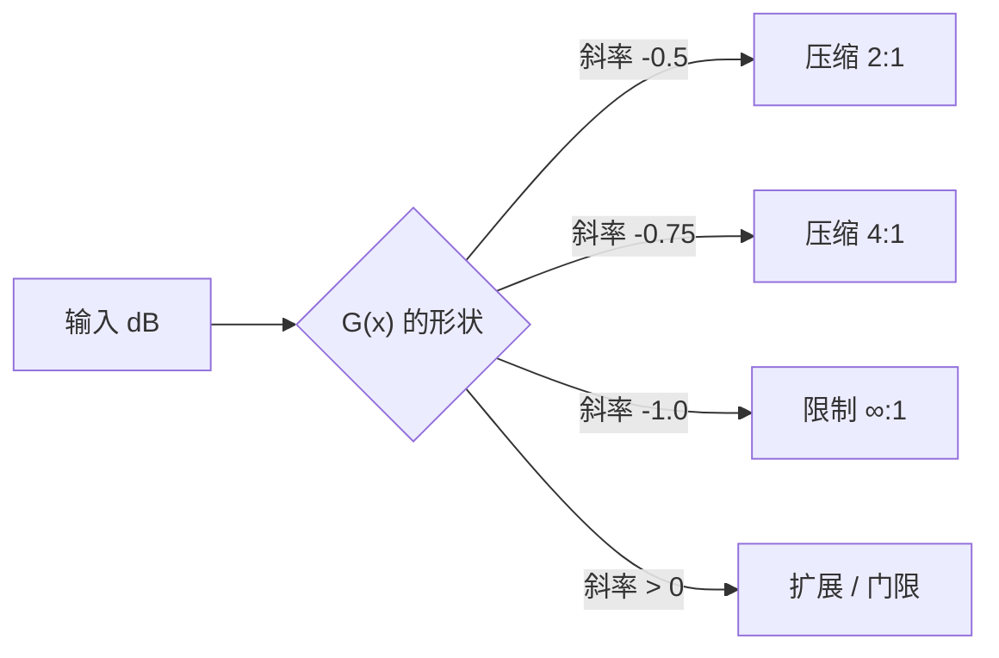

# 动态范围处理

> [!important] 一句话
> 压缩、限制、扩展、门限**共用同一个结构**——检测器 + 静态曲线 + 增益平滑——
> 区别只在**静态曲线的斜率符号与大小**。
> 本页讲**这条曲线怎么算**；"为什么这样调好听"在 [[动态处理的原理]]。

## 本页与 [[动态处理的原理]] 的分工

| | [[动态处理的原理]] | 本页 |
|---|---|---|
| 回答 | **音乐决策**：attack 快了会怎样、为什么总线要 2:1 | **数学与实现**：曲线方程、连续性证明、可编译代码 |
| 读者用它来 | 调参、判断"这个压缩器性格对不对" | 审阅 AI 写的 `computeGainDb`、写单元测试 |
| 典型内容 | GR 表、参数区间、glue 的机制 | Transfer curve、软膝的 C¹ 连续性、上下行压缩 |

> [!warning] 不要在本页找"参数该设多少"
> 本页**刻意不重复** [[动态处理的原理]] 的听感表格与参数区间。
> 遇到"人声该用多少 ratio"这类问题，去那一页。

---

## 一、四种动态处理的统一形式

**所有**动态处理都是同一个东西：

$$\boxed{\ \text{out}_{dB} = \text{in}_{dB} + G(\text{in}_{dB})\ }$$

$G(\cdot)$ 是**增益函数**（增益修正量，dB）。四种处理的差别**只在 $G$ 的形状**：

| 处理 | 目标 | $G$ 在阈值以上的行为 | 斜率 |
|---|---|---|---|
| **压缩（compress）** | 减小动态范围 | 负，且随输入**缓慢**变负 | $-1 < s < 0$ |
| **限制（limit）** | 绝不超上限 | 负，且**迅速**抵消输入增长 | $s \to -1$（ratio $\to \infty$） |
| **扩展（expand）** | 增大动态范围（向下） | 负，且随输入**减小**而更负 | $s < 0$（反向） |
| **门限（gate）** | 静音低电平 | 极负（趋向 $-\infty$） | 阶跃式 |



**增益衰减（gain reduction, GR）** 就是 $G$ 本身（它是负数）：
$\text{GR}_{dB} = \text{out}_{dB} - \text{in}_{dB} = G(\text{in}_{dB})$。

> [!important] 一句话记住四者的关系
> **压缩和限制是同一个公式的两种参数；扩展和门限是它的镜像。**
> 写代码时**不需要四个函数**——一个 `computeGainDb()` 加符号判断就够。
> 很多插件的 bug 就来自"压缩和限制写了两套代码，其中一套的膝没接上"。

---

## 二、Transfer curve 的数学

### 硬膝（hard knee）：定义与公式

设阈值 $T$（dB）、比率 $R$（$R > 1$）、输入 $x$（dB）。

$$\boxed{
G_{\text{hard}}(x) =
\begin{cases}
0 & x \le T\\[6pt]
\left(\dfrac{1}{R} - 1\right)(x - T) & x > T
\end{cases}}$$

**斜率** $s \equiv \dfrac{1}{R} - 1$，**恒为负**（因为 $R > 1$）。

| $R$ | $s = 1/R - 1$ | 超出 $T$ 12 dB 时的 GR |
|---|---|---|
| 1.5 | -0.3333 | -4.0 dB |
| 2 | -0.5000 | -6.0 dB |
| 4 | -0.7500 | -9.0 dB |
| 8 | -0.8750 | -10.5 dB |
| 20 | -0.9500 | -11.4 dB |
| $\infty$ | -1.0000 | -12.0 dB |

<!-- derived: 由 GR = (1/R-1)(x-T) 直接计算，x-T=12 -->

> [!warning] ratio 的感知是**非线性**的——这是数学事实，不是玄学
> 从上表看：$R$ 从 4 到 8，GR 只多 **1.5 dB**；从 8 到 $\infty$，只多 **1.5 dB**。
> 因为 $1/R$ 在 $R$ 大时趋于 0，**斜率趋于饱和**。
> **这就是为什么很多插件的 ratio 旋钮用非线性刻度或直接给档位。**
> 也是为什么"4:1 和 8:1 听起来差不多，1.5:1 和 2:1 差别很大"。

### 上下行压缩（upward / downward compression）

| | 下行压缩（downward） | 上行压缩（upward） |
|---|---|---|
| 作用 | 把**响的**压下来 | 把**轻的**抬上去 |
| 阈值语义 | **上限**：超过就压 | **下限**：低于就抬 |
| 斜率符号 | $s < 0$ | $s > 0$ |
| 听感 | 更紧凑、更"控制" | 更"密"、更"贴耳"、噪声底也被抬起 |
| 典型用途 | 99% 的压缩器 | 母带响度、播客、对白 |

$$\boxed{
G_{\text{up}}(x) =
\begin{cases}
\left(1 - \dfrac{1}{R}\right)(T - x) & x < T\\[6pt]
0 & x \ge T
\end{cases}}$$

> [!danger] 上行压缩会**抬起噪声底**
> 它把轻的部分（包括底噪、呼吸声、房间声）一起放大。
> **这是它和下行压缩最本质的代价**，且无法通过参数回避——
> 只能靠噪声门（gate）或降噪预处理。
>
> 另外：**上行压缩的阈值是"下限"**，参数名如果还叫 `threshold`，
> 用户会按下行压缩的直觉去调，然后完全搞错方向。**UI 上必须区分。**

### 扩展与门限

**向下扩展**（downward expansion）：低于阈值时**进一步压低**，斜率 $s_{\text{exp}} > 0$：

$$G_{\text{exp}}(x) = \begin{cases} (R_{\text{exp}} - 1)(T - x) & x < T\\ 0 & x \ge T\end{cases}
\qquad R_{\text{exp}} > 1$$

- $R_{\text{exp}} = 1$ → 无操作
- $R_{\text{exp}} = 2$ → 低于阈值 6 dB 的输入，再被压低 6 dB（动态范围翻倍）
- $R_{\text{exp}} \to \infty$ → **门限（gate）**：低于阈值直接静音

> [!warning] 门限必须做 **hysteresis（迟滞）**，否则会"颤振"
> 如果开启和关闭用**同一个阈值**，信号在阈值附近抖动时门限会
> 快速开合 → 产生"哒哒哒"的颤振（chattering）。这是门限最经典的 bug。
>
> **标准解法**：两个阈值。开启用 $T_{\text{open}}$，关闭用 $T_{\text{close}} = T_{\text{open}} - h$
> （$h$ 通常 3–10 dB）。**必须 $T_{\text{close}} < T_{\text{open}}$**（写反了门限会永远开着）。
>
> 还要配 **hold 时间**（保持时间）：检测到低于阈值后，先保持 N ms 再开始关闭，
> 避免在低频波形的过零点误关。

---

## 三、软膝：公式与**连续性证明**

**硬膝的问题**：$x = T$ 处斜率从 $0$ 跳到 $s$，**一阶导不连续** → 增益曲线有"折角"
→ 听感上是"抓取感"（grabby）。

**软膝**：在 $[T - W/2,\ T + W/2]$ 区间内让 $G$ **平滑地**从 $0$ 过渡到 $s \cdot W/2$。
$W$ 是膝宽（dB），$W = 0$ 即硬膝。

### 二次软膝（最常用）

$$\boxed{
G_{\text{soft}}(x) =
\begin{cases}
0 & 2(x - T) < -W\\[6pt]
s\,\dfrac{\left(x - T + \dfrac{W}{2}\right)^2}{2W} & \left|2(x-T)\right| \le W\\[10pt]
s\,(x - T) & 2(x - T) > W
\end{cases}}$$

### 实测：连续性（这是你写单元测试的断言）

$T = -20$ dB，$R = 4$（$s = -0.75$），$W = 12$ dB：

| 断言 | 实测 | 理论 | 结果 |
|---|---|---|---|
| $G(T - W/2) = 0$ | -0.0000000000 | 0 | ✅ |
| $G(T + W/2) = s \cdot W/2$ | -4.5000000000 | -4.5 | ✅ |
| $G(T + W) = s \cdot W$ | -9.0000000000 | -9.0 | ✅ |

<!-- derived: 50-Playground/exp-004-dynamics-math/exp_softknee.py §2，2026-10-14 实测 -->

**一阶导连续性**（中心差分 $h = 10^{-6}$，单位 dB/dB）：

| 实现 | $G'(T-W/2)$ | $G'(T)$ | $G'(T+W/2)$ | 硬膝斜率 |
|---|---|---|---|---|
| 硬膝 | 0.00000 | -0.37500 | -0.75000 | -0.75 |
| **二次软膝** | **-0.00000** | -0.37500 | **-0.75000** | -0.75 |
| softplus 膝 | -0.20171 | -0.37500 | -0.54829 | -0.75 |

<!-- derived: exp_softknee.py §3，2026-10-14 实测 -->

> [!important] 这张表说明了两件事
> 1. **二次软膝在两个边界上导数精确接上**（$0$ 和 $s$）→ 它是 $C^1$ 的，
>    **不需要"三次软膝"**。
> 2. **softplus 膝在边界处导数不为 0**（-0.2017 ≠ 0）→ 它**没有"不压缩"区**，
>    从 $-\infty$ 就开始压。虽然它是 $C^\infty$ 的，但**语义和"阈值"不符**。

> [!tip] 二次软膝 == Hermite 三次插值（实测恒等）
> 实测膝内 $\max|G_{\text{quad}} - G_{\text{Hermite}}| = 2.22\times10^{-15}$（即恒等）。
>
> **为什么**：Hermite 三次插值的边界条件是 $y(0)=0,\ y'(0)=0,\ y(1)=sW/2,\ y'(1)=sW$。
> 这四个条件解出的三次多项式，其三次项系数**恰好为 0**，退化成二次。
> **所以教科书里的"三次软膝"通常要么是同一个东西的误称，要么用了别的边界条件。**
> 你不需要实现三次版本。

```cpp
#include <cmath>
#include <algorithm>

// 统一的增益计算：软膝 + 硬膝 + 上行/下行
// xDb : 检测器电平(dB)   T : 阈值(dB)   R : ratio (>1)   W : 膝宽(dB)，0 = 硬膝
// upward = false → 下行压缩；true → 上行压缩
inline float computeGainDb (float xDb, float T, float R, float W, bool upward = false) noexcept
{
    R = std::max (R, 1.0f);                       // ⚠️ ratio 必须 >= 1，否则斜率符号反了
    W = std::max (W, 0.0f);                       // ⚠️ 膝宽不能为负

    const float slope = (upward ? (1.0f - 1.0f / R) : (1.0f / R - 1.0f));
    const float d     = upward ? (T - xDb) : (xDb - T);   // 上行时"低于阈值"为正

    if (W <= 0.0f)                                        // 硬膝
        return (d > 0.0f) ? slope * d : 0.0f;

    const float halfW = W * 0.5f;
    if (d <= -halfW) return 0.0f;                         // 膝下：不处理
    if (d >=  halfW) return slope * d;                    // 膝上：正常斜率
    const float t = d + halfW;                            // 膝内：二次插值
    return slope * t * t / (2.0f * W);
}
```

### 膝宽对 GR 的影响（实测）

$T = -20$ dB，$R = 4$：

| 输入 dB | W=0（硬） | W=3 | W=6 | W=12 | W=20 | W=30 |
|---|---|---|---|---|---|---|
| -30 | 0.000 | 0.000 | 0.000 | 0.000 | -0.000 | **-0.312** |
| -26 | 0.000 | 0.000 | 0.000 | -0.000 | **-0.300** | -1.012 |
| -23 | 0.000 | 0.000 | -0.000 | **-0.281** | -0.919 | -1.800 |
| -20 | 0.000 | **-0.281** | **-0.562** | **-1.125** | -1.875 | -2.812 |
| -17 | -2.250 | -2.250 | -2.250 | -2.531 | -3.169 | -4.050 |
| -14 | -4.500 | -4.500 | -4.500 | -4.500 | -4.800 | -5.513 |
| -8 | -9.000 | -9.000 | -9.000 | -9.000 | -9.000 | -9.113 |

<!-- derived: exp_softknee.py §4，2026-10-14 实测 -->

> [!danger] 软膝会改变"有效阈值"——这是"参数照抄却更狠"的真正原因
> 看 $W=12$ 那一列：在 $x = T = -20$ dB 处**已经压了 1.125 dB**。
> 而 $W=30$ 时，在 **$T-10 = -30$ dB** 处就已经开始压了（-0.312 dB）。
>
> **解析公式**：膝内 $|G| = |s|\dfrac{(d + W/2)^2}{2W}$，
> 反解出"达到 $|G| = g$ 所需的输入"：
>
> $$d = -\frac{W}{2} + \sqrt{\frac{2Wg}{|s|}}$$
>
> **实测验证**（$T=-20$, $R=4$, 即 $|s|=0.75$）：
>
> | $W$ | $\|G\|=0.5$ 理论 | 实测 | $\|G\|=1.0$ 理论 | 实测 |
> |---|---|---|---|---|
> | 3 dB | -19.500 | -19.500 | -18.672 | -18.672 |
> | 6 dB | -20.172 | -20.172 | -19.000 | -19.000 |
> | 12 dB | -22.000 | -22.000 | -20.343 | -20.343 |
> | 20 dB | -24.836 | -24.836 | -22.697 | -22.697 |
>
> <!-- derived: exp_softknee.py §5，2026-10-14 实测 -->
>
> ⚠️ **这个解析式只在膝内有效**，即要求 $|G| \le |s|\dfrac{W}{2}$（膝顶的 GR）。
> 超出后膝已经结束，进入正常压缩段（斜率 $s$ 的直线），公式不再适用。
> 例：$W = 3$ dB、$|s| = 0.75$ 时膝顶只有 $1.125$ dB，所以"$|G|=3$ dB 在哪里"
> 这个问题**没有膝内解**——那时压缩器已在线性段。
>
> **用户把硬膝插件的参数抄到你的软膝插件上，会得到更多 GR，然后抱怨"你这个压得狠"。**
> **做法**：① UI 上明确显示膝宽 ② 把 threshold 定义为膝的**中心**并在文档里写清
> ③ 提供一个"膝宽 = 0"的档位让用户能对齐。

---

## 四、完整实现：从检测到增益

```cpp
#include <cmath>
#include <algorithm>

class Compressor
{
public:
    void prepare (double sampleRate) noexcept
    {
        sr = sampleRate;
        setAttack (10.0);  setRelease (100.0);
        env = 0.0f; gainDb = 0.0f;
    }

    void setThreshold (float db)  noexcept { thresholdDb = db; }
    void setRatio     (float r)   noexcept { ratio = std::max (r, 1.0f); }
    void setKnee      (float w)   noexcept { kneeDb = std::max (w, 0.0f); }
    void setAttack    (double ms) noexcept { attCoeff = coeffFor (ms); }
    void setRelease   (double ms) noexcept { relCoeff = coeffFor (ms); }

    // 立体声链接：两个声道必须用**同一个**增益
    // 返回本样本应施加的线性增益
    float process (float x) noexcept
    {
        const float rect = std::fabs (x);
        env += ((rect > env) ? attCoeff : relCoeff) * (rect - env);

        const float xDb = 20.0f * std::log10 (env + 1.0e-9f);
        const float targetDb = computeGainDb (xDb, thresholdDb, ratio, kneeDb);

        // ⚠️ 平滑的是**增益**（dB），不是电平
        gainDb += 0.0005f * (targetDb - gainDb);
        return std::pow (10.0f, gainDb / 20.0f);
    }

    float getGainReductionDb() const noexcept { return gainDb; }

private:
    double sr = 48000.0;
    float thresholdDb = -20.0f, ratio = 4.0f, kneeDb = 6.0f;
    float attCoeff = 0.01f, relCoeff = 0.0001f;
    float env = 0.0f, gainDb = 0.0f;

    float coeffFor (double ms) const noexcept
    {
        if (ms <= 0.0) return 1.0f;
        return (float) (1.0 - std::exp (-1.0 / (ms * 0.001 * sr)));
    }

    static float computeGainDb (float xDb, float T, float R, float W) noexcept
    {
        R = std::max (R, 1.0f);  W = std::max (W, 0.0f);
        const float slope = 1.0f / R - 1.0f;      // 负
        const float d = xDb - T;
        if (W <= 0.0f) return (d > 0.0f) ? slope * d : 0.0f;
        const float halfW = W * 0.5f;
        if (d <= -halfW) return 0.0f;
        if (d >=  halfW) return slope * d;
        const float t = d + halfW;
        return slope * t * t / (2.0f * W);
    }
};
```

> [!warning] 检测器与增益平滑的细节见其他页
> - **检测器（peak/RMS、系数公式、检测前高通）** → [[包络跟随器 envelope follower]]
> - **增益平滑的时间常数与域** → [[参数平滑 parameter smoothing]]
> - **denormal**（`env` 和 `gainDb` 都会掉进去）→ [[denormal 数处理]]
> - **lookahead 与延迟报告** → [[延迟报告 latency reporting]]

---

## 五、AI 会怎么写错

| # | AI 常写 | 为什么错 | 怎么查 |
|---|---|---|---|
| 1 | **`R` 没钳制到 $\ge 1$** | $R<1$ 时斜率变正 → 压缩器变成扩展器 | 断言 $R \ge 1$，或 UI 上限/下限 |
| 2 | **膝宽 $W$ 允许为负** | 二次公式的 $t^2/(2W)$ 变号 → 膝内增益**反向** | `W = max(W, 0)` |
| 3 | **平滑电平而不是平滑增益** | 增益会跟着波形抖 → 失真（这是"release 太快"的机制） | 看 `+= coeff*(...)` 作用在哪个变量 |
| 4 | **dB 换算用了 `/20` 又用 `/10`** | 幅度 vs 功率混淆 → GR 差一倍 | 断言：输入 -6 dBFS 正弦的 `xDb` 应为 -6 |
| 5 | **膝公式写成 `slope*(d+W/2)²/W`** | 少了 2 → 膝上边界处**不连续**（差 2 倍） | 断言 $G(T+W/2) = sW/2$ |
| 6 | **膝上段用 `slope*(d)` 但膝内用 $d$ 而非 $d+W/2$** | 边界不连续 | 同上 |
| 7 | **`log10(0)`** | 输入静音时 `xDb = -inf` → NaN | 加 `+1e-9` 或用 `std::max(env, 1e-9)` |
| 8 | **`pow(10, ...)` 每样本调两次** | 超越函数贵 | 可接受；但先 profile 再优化 |
| 9 | **立体声左右各自算增益** | 声像摇摆 | 用 `max(\|L\|,\|R\|)` 或 `sqrt((L²+R²)/2)` |
| 10 | **门限不做 hysteresis** | 阈值附近颤振 | 两个阈值 + hold 时间 |
| 11 | **上行压缩的 threshold 语义没在 UI 区分** | 用户调反方向 | 改名或明确标注 |
| 12 | **`env` / `gainDb` 不防 denormal** | 静音时 CPU 飙升 | 见 [[denormal 数处理]] |
| 13 | **在 `processBlock` 里算 `exp()` 系数** | 违反实时契约 | 系数在 `prepare`/参数变化时算 |
| 14 | **自动 makeup gain 用 `-computeGainDb(0.0f, ...)`** | 假设输入总是满刻度 → 过度补偿 | 见 [[动态处理的原理]] §8 |

> [!tip] 第 5、6 条是同一个错误的两种表现
> **软膝公式的验证只需要两个断言**（$W$ 边界处的值）。
> 如果 AI 写错了，这两个断言会立刻失败——
> 而**听感上你只会觉得"有点抓"，很难归因到公式**。
> **先写这两个断言，再让 AI 写实现。**

---

## 六、常见坑

| 症状 | 原因 | 解法 |
|---|---|---|
| 增益曲线有"折角"、有抓取感 | 膝宽为 0，或膝公式不连续 | 加软膝；断言边界连续 |
| 换插件后"压得更狠" | 膝宽不同 → 有效阈值偏移 | 见 §3 的解析公式 |
| 压缩器变成扩展器 | $R < 1$ | 钳制 $R \ge 1$ |
| 静音时输出 NaN | `log10(0)` | `+1e-9` 或 clamp |
| 门限"哒哒"颤振 | 无 hysteresis | 双阈值 + hold |
| 上行压缩后底噪变大 | 上行压缩的固有代价 | 加门限或降噪 |
| 声像左右摇摆 | 检测器未链接 | `max(\|L\|,\|R\|)` |
| 静音时 CPU 飙升 | denormal | 见 [[denormal 数处理]] |
| 参数拖动爆音 | 增益未平滑 | 见 [[参数平滑 parameter smoothing]] |
| 限制器仍过冲 | 无 lookahead | 见 [[延迟报告 latency reporting]] |

---

## 七、怎么验证

> [!important] 数值验证优先于听感
> 静态曲线能在 30 秒内抓出阈值定义错、ratio 公式错、膝宽符号错、dB 换算错。

| # | 验证什么 | 方法 | 通过标准 |
|---|---|---|---|
| 1 | **静态曲线形状** | 喂稳态正弦扫 -60 → 0 dBFS，画输出 vs 输入 | 折线：折点在 $T$，斜率 $1/R$ |
| 2 | **软膝连续性** | 断言 $G(T-W/2)=0$ 且 $G(T+W/2)=sW/2$ | 差值 $< 10^{-6}$ |
| 3 | **软膝 C¹** | 数值求导，比较膝两端与硬膝斜率 | 两端分别为 $0$ 和 $s$ |
| 4 | **时间常数** | 喂阶跃，测 GR 到 63% 的时间 | 等于设定的 attack/release |
| 5 | **无过冲** | 白噪声 + 随机瞬态，$R=\infty$，$T=-1$ | `max(\|out\|) <= 1.0` |
| 6 | **立体声链接** | 左满刻度、右 -20 dBFS | 两声道 GR 差 $< 0.01$ dB |
| 7 | **门限 hysteresis** | 缓慢扫过阈值的信号 | 无颤振（开合次数 = 1） |

```python
import numpy as np

def gain_db(x_db, T, R, W):
    """软膝增益函数（与 C++ 版本逐字对应）"""
    s = 1.0/R - 1.0
    d = x_db - T
    if W <= 0:  return s*d if d > 0 else 0.0
    if d <= -W/2: return 0.0
    if d >=  W/2: return s*d
    return s*(d + W/2)**2 / (2*W)

T, R, W = -20.0, 4.0, 12.0
s = 1.0/R - 1.0

# ① 边界连续性 —— 这两个断言就能抓住公式错误
assert abs(gain_db(T - W/2, T, R, W)) < 1e-12, "膝下边界不连续！"
assert abs(gain_db(T + W/2, T, R, W) - s*W/2) < 1e-12, "膝上边界不连续！"
print(f"✅ 边界连续：G(T-W/2)={gain_db(T-W/2,T,R,W):.10f}, "
      f"G(T+W/2)={gain_db(T+W/2,T,R,W):.10f} (理论 {s*W/2})")

# ② 一阶导连续（C¹）
h = 1e-6
d_lo = (gain_db(T-W/2+h, T,R,W) - gain_db(T-W/2-h, T,R,W)) / (2*h)
d_hi = (gain_db(T+W/2+h, T,R,W) - gain_db(T+W/2-h, T,R,W)) / (2*h)
assert abs(d_lo) < 1e-6,  f"膝下边界导数应为 0，实测 {d_lo}"
assert abs(d_hi - s) < 1e-6, f"膝上边界导数应为 {s}，实测 {d_hi}"
print(f"✅ C¹ 连续：G'(T-W/2)={d_lo:.6f}（理论 0）, G'(T+W/2)={d_hi:.6f}（理论 {s}）")

# ③ 单调性：膝内 GR 必须单调
xs = np.linspace(T-W/2, T+W/2, 1000)
g = np.array([gain_db(x, T, R, W) for x in xs])
assert np.all(np.diff(g) <= 1e-12), "膝内增益不单调！"
print("✅ 膝内单调递减")

# ④ 硬膝 vs 软膝的"有效阈值偏移"（解析式验证）
for Wt in [3.0, 6.0, 12.0, 20.0]:
    d_theory = -Wt/2 + np.sqrt(2*Wt*1.0/abs(s))     # 达到 |GR|=1.0 所需
    # 数值反解
    xs = np.linspace(T-40, T, 200001)
    gs = np.array([gain_db(x, T, R, Wt) for x in xs])
    idx = np.argmax(gs <= -1.0)
    print(f"   W={Wt:>4}dB: |GR|=1.0 理论在 {T+d_theory:>8.3f} dB, "
          f"数值 {xs[idx]:>8.3f} dB")
print("\n✅ 全部通过")
```

> [!tip] 断言 ① 和 ② 是**最高杠杆**的两个测试
> 它们只需要 $O(1)$ 时间，却能在你写完整插件之前抓出：
> 膝公式少了个 2、$W$ 的符号错、膝上/膝下段的分界写错。
> **先写它们，再让 AI 写实现。**

---

## 相关

- [[动态处理的原理]] — **本页的互补页**：音乐决策、参数区间、glue 的机制
- [[包络跟随器 envelope follower]] — 检测器：peak vs RMS、系数公式、检测前高通
- [[参数平滑 parameter smoothing]] — 增益平滑（平滑的是增益，不是电平）
- [[denormal 数处理]] — `env` / `gainDb` 都会掉进 denormal 区
- [[延迟报告 latency reporting]] — lookahead 限制器的延迟必须申报
- [[旁路 bypass 的正确实现]] — 有延迟的压缩器旁路时要保持延迟
- [[混叠 aliasing]] — 增益平滑是时变的，快速变化会产生边带
- [[Biquad 滤波器]] — 检测器前的高通就是它
- [[MOC - DSP]] · [[MOC - Music & Acoustics]]

> [!note] 待补充
> - **反馈式 vs 前馈式拓扑**：检测器看输入还是输出，对曲线的影响
> - **多段压缩**：分频点、Linkwitz-Riley 的相位问题、各段检测器如何链接
> - **程序相关 release 的数学**：双时间常数、GR 相关的可变 release
> - **门限的完整实现**：hysteresis + hold + 淡入淡出，附实测
> - **上行压缩的噪声底实测**：抬升多少 dB，与 ratio/阈值的关系
> - **限制器的 intersample peak**：true-peak 检测与过采样的必要性
