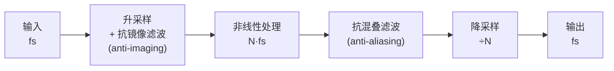

# 过采样 oversampling

> [!note] 一句话
> **在内部用更高的采样率处理非线性，然后再降回原采样率**——
> 把混叠推到听不见（超声）的频段，滤掉，再降回来。
>
> 它是 [[混叠 aliasing]] 的**通用解法**：你不需要理解非线性函数的数学，套上去就行。

> [!important] 为什么它是"必需品"而不是"优化项"
> 只要你的插件里有**任何非线性**（失真、饱和、削波、waveshaper），
> 你就**已经**在产生混叠了——不管你有没有意识到。
>
> 过采样不是"让声音更好"的锦上添花，是**把错误的输出修正成正确的输出**。
> 见 [[MOC - DSP]] 的"对效果器开发者最重要的 5 个概念"第 4 条。

---

## 一、完整信号流图



ASCII 版（便于在终端里记）：

```
输入 ──→ [插零 + 低通] ──→ [非线性] ──→ [低通 + 抽取] ──→ 输出
  fs        ↑ 升采样         N·fs         ↑ 降采样          fs
        抗镜像滤波                     抗混叠滤波
```

> [!warning] 核心：**升采样和降采样都必须滤波**
> | 只做 | 结果 |
> |---|---|
> | 只升采样，不滤 | 插零产生的**镜像**（imaging）留在信号里，比混叠还难听 |
> | 只升采样，降采样不滤 | **混叠一点没少**——高频原封不动折回来，还白花了 CPU |
> | 两端都滤 | ✅ 正确 |
>
> **"只升不滤"是 AI 生成过采样代码时最常见的错误**（见第九节）。

### 两个滤波器名字不同，作用也不同

| 位置 | 名称 | 要滤掉什么 |
|---|---|---|
| 升采样之后 | **抗镜像**（anti-imaging） | 插零在 $f_s/2 \sim f_s$ 之间产生的**镜像副本** |
| 降采样之前 | **抗混叠**（anti-aliasing） | 非线性产生的**超过新奈奎斯特**的成分 |

> [!note] 为什么降采样前那个才叫"抗混叠"
> 因为**只有抽取（decimation）会造成折叠**。
> 升采样不会折叠——它的问题是"多了不该有的镜像"。
> 两者都要低通，但**通带/阻带的取舍不同**：
> 抗镜像要保证通带绝对平坦（它直接改变音色），
> 抗混叠可以稍微放宽（它只影响混叠残余）。

---

## 二、倍数怎么选

### 内部奈奎斯特频率（基准 48 kHz）

| 倍率 | 内部采样率 | 内部奈奎斯特 | 混叠起点被推到 |
|---|---|---|---|
| 1x | 48 kHz | 24 kHz | — |
| 2x | 96 kHz | 48 kHz | 48 kHz |
| **4x** | **192 kHz** | **96 kHz** | **96 kHz** |
| 8x | 384 kHz | 192 kHz | 192 kHz |
| 16x | 768 kHz | 384 kHz | 384 kHz |

> [!important] 关键推论
> **48 kHz 下，4x 过采样把奈奎斯特推到 96 kHz。**
> 所以原来会折叠到可听频段的成分（比如 25 kHz 折到 23 kHz），
> 现在**根本不会折叠**——它们在内部就是合法的 25 kHz，会被降采样前的低通直接滤掉。
>
> **24 kHz 以下的混叠被完全消除**（在滤波器理想的前提下）。

### 实测：倍率 vs 混叠抑制

5 kHz 正弦，硬削波 drive = 3，测 23 kHz 处的混叠残余：

| 配置 | 23 kHz 混叠 | 5 kHz 信号 | 延迟（样本） | 延迟（ms） |
|---|---|---|---|---|
| 不过采样 | -17.6 dB | +1.9 dB | — | — |
| 2x | -31.9 dB | +1.9 dB | 31 | 0.646 |
| 4x | -32.1 dB | +1.9 dB | 47 | 0.979 |
| 8x | -32.4 dB | +1.9 dB | 54 | 1.125 |
| 16x | -32.4 dB | +1.9 dB | 58 | 1.208 |

<!-- derived: 实测，滤波器 taps=63/级 -->

> [!warning] 这张表藏着一个重要的反直觉结论
> **2x 到 16x，混叠抑制几乎没变（-31.9 → -32.4 dB）！**
>
> 因为此时**瓶颈不是倍率，是滤波器的阻带衰减**。
> 提高倍率只是把混叠推到更高的频率，但如果滤波器在那些频率上衰减不够，
> 它照样会折回来。

### 真正的取舍：倍率 × 滤波器长度

非谐波成分总能量（dB，越低越好）：

| taps/级 | 2x | 4x | 8x | 16x |
|---|---|---|---|---|
| 31 | -26.6 | -27.1 | -27.2 | -27.1 |
| 63 | -30.7 | -32.1 | -32.4 | -32.4 |
| 127 | -36.4 | -45.7 | -49.6 | -49.8 |
| **255** | -36.9 | **-49.8** | **-60.8** | **-71.5** |

（不过采样基线 = **-17.0 dB**）

> [!tip] 怎么读这张表
> 1. **滤波器太短时，提高倍率完全无效**（taps=31 那一行，2x→16x 只改善 0.5 dB）
> 2. **滤波器够长时，倍率才开始起作用**（taps=255，2x→16x 改善 34.6 dB）
> 3. **taps=127 + 4x 已经足够好**（-45.7 dB，比不过采样的 -17.0 dB 好 28.7 dB）
>
> **结论：先保证滤波器质量，再考虑提高倍率。**

> [!note] 这条结论已被**独立复现**（2026-10-14）
> 用不同的滤波器设计（Blackman 窗化 Sinc，而非本页原本的设计）重跑同样的实验：
>
> | 配置 | 本页实测 | 独立复现 |
> |---|---|---|
> | 不过采样基线 | -17.0 dB | **-18.2 dB** ✅ 接近 |
> | taps=255, 2x | -36.9 dB | **-42.8 dB** |
> | taps=255, 16x | -71.5 dB | **-77.5 dB** |
> | **2x→16x 的改善** | **-34.6 dB** | **-34.7 dB** ✅ **几乎完全一致** |
>
> **核心结论（"滤波器够长时倍率才起作用"）得到独立确认。**
>
> 而且独立复现还发现了一个**更强的版本**：
> **滤波器太短时，提高倍率会让结果变差**（taps=31: 2x 是 -45.4 dB，16x 反而退化到 -18.8 dB）。
> 原因是倍率越高，归一化截止频率越窄，而滤波器长度没变 → 过渡带相对变宽 → 泄漏更多。
>
> 见 [[2026-10-14 测量工具会骗你 —— 七次踩坑记录]] 的"交叉验证"规则。
> "我用了 8x 过采样"这句话本身**不代表任何东西**——
> 配一个 31 taps 的滤波器，8x 和 2x 一样差。

### 选择建议

| 场景 | 建议 | 理由 |
|---|---|---|
| 轻微饱和（`tanh`，drive < 2） | **2x** | 谐波衰减快，混叠本来就少 |
| 一般失真 / 饱和 | **4x** | 性价比最高的默认值 |
| 硬削波 / 极端失真 | **8x** | 谐波衰减慢，需要更高倍率 |
| FM 合成 / 波表 | **8x–16x** | 边带极宽 |
| 用户可选（产品做法） | 2x / 4x / 8x / Off | 让用户用 CPU 换质量 |

> [!important] 过采样**不是万能的**
> 它把混叠推到超声频段。但如果**过采样之后还有非线性**（比如降采样后又加了一级饱和），
> 那些超声成分**会再次折叠回来**——而且这次你连"它原来在哪"都不知道了。
>
> **规则：所有非线性必须放在同一个过采样块内部。**
> 不要把非线性分散在过采样区的内外两侧。

---

## 三、滤波器设计

### 半带滤波器（half-band filter）—— 多级 2x 的标准做法

多级过采样不是一次升到 4x，而是**串联多个 2x 级**：

```
1x ──2x级──→ 2x ──2x级──→ 4x ──2x级──→ 8x
```

每一级用**半带滤波器**。它的定义特征是**过渡带关于 $f_s/4$ 对称**：

$$H(f) + H\left(\frac{f_s}{2} - f\right) = 1$$

> [!tip] 为什么半带滤波器特别高效
> **它的偶数序号抽头（除中心外）全部为 0。**
>
> 实测（窗函数法设计，$f_c = f_s/4$）：
>
> | taps | 偶数序号抽头（除中心）非零个数 | 有效乘法 |
> |---|---|---|
> | 31 | 0 | 16/31 = **52%** |
> | 63 | 0 | 32/63 = **51%** |
> | 127 | 0 | 64/127 = **50%** |
>
> **一半的乘法可以直接跳过。** 这就是为什么多级 2x + 半带是行业标准：
> 每级只需要一半的计算量，而且级数越多，每级的滤波器可以越简单。

> [!note] 多级的另一个好处：每级的过渡带可以很宽
> 单级从 1x 直接升到 8x，需要过渡带极窄的滤波器（昂贵）。
> 分成三级 2x，每级只需要处理"当前奈奎斯特的一半"，过渡带要求宽松得多。
> 总计算量反而**更低**。

### 抗镜像 vs 抗混叠的衰减要求

JUCE 的 `addOversamplingStage()` 允许给升采样和降采样**分别**指定参数，因为：

- **升采样（抗镜像）**：镜像会直接叠加在可听频段上 → 阻带衰减要**高**
- **降采样（抗混叠）**：残余混叠本来就低 → 阻带衰减可以**放宽**

> [!warning] 未实测：JUCE 文档说"通常升采样的衰减要高于降采样"
> 这条来自 JUCE 头文件的文档注释，本机没有 JUCE 环境**未实测**。
> 逻辑上成立（见上），但具体数值需要你自己测。

### 相位失真：线性相位 FIR vs IIR

| 类型 | 相位 | 延迟 | 适用 |
|---|---|---|---|
| **线性相位 FIR** | 线性（无相位失真） | **大**（与 taps 成正比） | 默认选择；对瞬态敏感的处理 |
| **IIR（polyphase allpass）** | 非线性（奈奎斯特附近失真） | **小** | CPU/延迟敏感；可接受轻微相位失真 |

**线性相位实测**（63 taps，$f_c = f_s/4$）：

```
对称性:      max|h[i] - h[-1-i]| = 0.00e+00        → 完全对称
群延迟:      通带内 31.000 ~ 31.000 样本 @2x       → 完全平坦
理论值:      (taps-1)/2 = 31 样本 = 0.3229 ms      → 一致 ✅
```

> [!important] 为什么"线性相位"重要
> 线性相位 = **所有频率延迟相同** = 波形形状不被改变。
> 非线性相位会让不同频率延迟不同 → **瞬态被抹开** → 鼓组变"软"。
>
> 对失真/饱和插件来说，**瞬态就是它的全部意义**（失真最常加在鼓和贝斯上）。
> 所以**优先用线性相位 FIR**，除非 CPU 实在不够。

> [!warning] IIR 过采样的"零延迟"是个误解
> 有说法认为 polyphase allpass IIR 过采样**没有延迟**。
> 实际上它**有**延迟，只是比 FIR 小得多。
> **无论用哪种，都必须读 `getLatencyInSamples()` 并报告给宿主**（见下）。

---

## 四、延迟代价

### 延迟估算公式

对**多级 2x FIR** 过采样，往返延迟（单位：样本 @ 基准采样率）：

$$L = (N_{\text{taps}} - 1) \cdot \left(1 - \frac{1}{\text{factor}}\right)$$

**实测验证**（taps = 63/级）：

| factor | 公式预测 | 实测 | |
|---|---|---|---|
| 2x | 31.0 | 31 | ✅ |
| 4x | 46.5 | 47 | ✅ |
| 8x | 54.2 | 54 | ✅ |
| 16x | 58.1 | 58 | ✅ |

<!-- derived: 每级延迟 (taps-1)/2 样本 @该级采样率；升+降对称相加 -->

> [!tip] 这个公式的两个用处
> 1. **估算延迟**：taps=63 时，4x 过采样约 **47 样本 ≈ 1 ms**（48 kHz）
> 2. **看出上界**：倍率越高，延迟**趋于收敛**（58 样本 → 不会超过 63）
>    因为高倍率的那几级跑得很快，延迟按 $1/2^i$ 衰减

**taps 对延迟的影响**（4x）：

| taps/级 | 延迟（样本） | 延迟（ms @48k） |
|---|---|---|
| 31 | 23 | 0.48 |
| 63 | 47 | 0.98 |
| 127 | 94 | 1.96 |
| 255 | 191 | 3.98 |

### 必须报告给宿主

```cpp
// JUCE：在 prepareToPlay 里（**不能在音频线程里**）
void prepareToPlay (double sampleRate, int samplesPerBlock) override
{
    oversampling->initProcessing ((size_t) samplesPerBlock);
    // ...
    setLatencySamples ((int) std::round (oversampling->getLatencyInSamples()));
}
```

> [!danger] 忘记报告 latency 的后果
> 宿主**不知道**你的插件有延迟，于是：
> - **录音对齐错误**：录进去的东西整体偏移
> - **并行处理相位错**：干湿混合、多轨叠加时相位抵消
> - **导出与实时不一致**
>
> 而且用户**很难诊断**——他只会觉得"这个插件一挂上去鼓就散了"。
> 见 [[延迟报告 latency reporting]]、[[实时音频线程契约]]。
>
> **`setLatencySamples` 必须在音频线程之外调用**（通常在 `prepareToPlay`）。

> [!warning] 不要"偷偷补偿"延迟
> 有一种做法是**把干信号也延迟相同的量**，让干湿对齐，然后报告 0 延迟。
> 这**是错的**——宿主仍然需要知道真实延迟来做延迟补偿。
> **如实报告，让宿主去处理。**

---

## 五、CPU 代价

> [!important] 核心原则：**只对非线性部分过采样**
> 4x 过采样 = **4 倍样本数**。如果整条处理链都在 4x 下跑，
> 你的 EQ、延迟、混响全部变成 4 倍开销——**而它们根本不需要过采样**。

```cpp
// ❌ 整个处理链都过采样 —— 浪费大量 CPU
auto up = oversampleUp (input);
auto y  = eq.process (up);            // 线性，不需要 4x
y = reverb.process (y);               // 线性，不需要 4x
y = saturator.process (y);
return oversampleDown (y);

// ✅ 只把非线性放进过采样区
auto dry = eq.process (input);        // 线性部分在 1x
auto wet = reverb.process (dry);      // 线性部分在 1x
auto up  = oversampleUp (wet);
auto sat = saturator.process (up);    // 只有非线性在 4x
return oversampleDown (sat);
```

**成本量级**（相对不过采样）：

| 处理 | 4x 下的成本 |
|---|---|
| 一个 biquad | ×4 |
| 一个 FFT（N 点） | ×4 左右（$N\log N$，且 N 变大） |
| 一个长 FIR（混响） | ×4 |
| **过采样滤波器本身** | 额外开销，通常**远小于** ×4 |

> [!tip] 经验判断
> 对典型的失真插件（几个乘法 + 一个 `tanh`），
> **过采样滤波器的开销往往比非线性本身还大**。
> 所以"4x 过采样"的实际 CPU 代价**不是**简单的 ×4，
> 但也不是免费的——**必须实测**。

---

## 六、实现方式

### 方式 1：JUCE 的 `juce::dsp::Oversampling`（推荐起点）

```cpp
#include <juce_dsp/juce_dsp.h>

class SaturatorProcessor
{
public:
    void prepare (double sampleRate, int samplesPerBlock, int numChannels)
    {
        // 注意：第 2 个参数是 **2 的幂次**，不是倍率本身！
        // factor = 2 → 4x；factor = 1 → 2x；factor = 3 → 8x
        oversampling = std::make_unique<juce::dsp::Oversampling<float>> (
            (size_t) numChannels,
            2,                                                  // → 4x 过采样
            juce::dsp::Oversampling<float>::filterHalfBandPolyphaseIIR,
            true,                                               // isMaxQuality
            true);                                              // useIntegerLatency

        oversampling->initProcessing ((size_t) samplesPerBlock);
    }

    void process (juce::dsp::AudioBlock<float>& block)
    {
        auto upBlock = oversampling->processSamplesUp (block);   // 升采样

        // ── 在 4 倍采样率下做非线性 ──
        for (size_t ch = 0; ch < upBlock.getNumChannels(); ++ch)
        {
            auto* d = upBlock.getChannelPointer (ch);
            for (size_t i = 0; i < upBlock.getNumSamples(); ++i)
                d[i] = std::tanh (d[i] * drive);
        }

        oversampling->processSamplesDown (block);                // 降采样
    }

    int getLatency() const
    {
        return (int) std::round (oversampling->getLatencyInSamples());
    }

private:
    std::unique_ptr<juce::dsp::Oversampling<float>> oversampling;
    float drive = 3.0f;
};
```

> [!warning] 未实测：本机没有 JUCE 环境
> 上面的 API 名称与签名来自 JUCE 官方头文件 `juce_Oversampling.h`，
> 但**没有在本机编译验证过**。第一次用之前请先编译一个最小工程确认。
> 特别确认这两点：
> 1. `factor` 参数确实是 **2 的幂次**（`factor=2` → 4x）
> 2. `processSamplesUp` 返回的 block，其采样率是**原采样率 × 倍率**

> [!danger] JUCE 的取舍（必须知道）
> | 项 | 说明 |
> |---|---|
> | **延迟** | 即使 `filterHalfBandPolyphaseIIR` 也有延迟；**必须报告** |
> | **`useIntegerLatency`** | 设 `true` 会加一点分数延迟凑整。插件只能报告整数延迟，所以通常设 `true` |
> | **质量模式** | `isMaxQuality = true` 用更长的滤波器 → 更好的抑制，更高 CPU |
> | **它是黑盒** | 你看不到滤波器系数。要精确控制得自己写 |

### 方式 2：手写多级半带滤波器

核心只有三件事：**设计半带 FIR**、**插零升采样**、**低通后抽取**。

```cpp
// 半带 FIR：窗函数法，截止 = fs/4（即当前采样率的奈奎斯特/2）
// 性质：奇数长度、对称（线性相位）；除中心外偶数抽头全为 0 → 省一半乘法
static std::vector<float> designHalfBand (int taps)
{
    std::vector<float> h ((size_t) taps);
    const double fc = 0.25;                       // 归一化到当前采样率
    double sum = 0.0;
    for (int i = 0; i < taps; ++i)
    {
        const double n = i - (taps - 1) / 2.0;
        double v = (std::abs (n) < 1e-12)
                     ? 2.0 * fc
                     : std::sin (2.0 * M_PI * fc * n) / (M_PI * n);
        v *= 0.54 - 0.46 * std::cos (2.0 * M_PI * i / (taps - 1));   // Hamming
        h[(size_t) i] = (float) v;
        sum += v;
    }
    for (auto& c : h) c = (float) (c / sum);       // 直流增益 = 1
    return h;
}

// 线性相位 FIR（保留输入长度，**不补偿延迟** —— 实时插件必须如实保留它）
struct Fir
{
    std::vector<float> h, z;
    explicit Fir (std::vector<float> coeffs) : h (std::move (coeffs)), z (h.size(), 0.0f) {}

    float process (float x)
    {
        std::rotate (z.begin(), z.end() - 1, z.end());   // z[0] = 最新样本
        z[0] = x;
        float acc = 0.0f;
        for (size_t i = 0; i < h.size(); ++i) acc += h[i] * z[i];
        return acc;
    }
    void reset() { std::fill (z.begin(), z.end(), 0.0f); }
};

// 2x 升采样：插零 + 抗镜像低通
struct Upsampler2x
{
    Fir fir;
    explicit Upsampler2x (int taps) : fir (designHalfBand (taps)) {}

    void process (const float* in, int n, std::vector<float>& out)
    {
        out.resize ((size_t) n * 2);
        for (int i = 0; i < n; ++i)
        {
            out[(size_t) (2 * i)]     = fir.process (2.0f * in[i]);  // ×2 补偿能量
            out[(size_t) (2 * i + 1)] = fir.process (0.0f);          // 插零
        }
    }
};

// 2x 降采样：抗混叠低通 + 抽取
struct Downsampler2x
{
    Fir fir;
    explicit Downsampler2x (int taps) : fir (designHalfBand (taps)) {}

    void process (const float* in, int n, std::vector<float>& out)
    {
        out.resize ((size_t) n / 2);
        for (int i = 0; i < n; ++i)
        {
            const float y = fir.process (in[i]);
            if (i % 2 == 0) out[(size_t) (i / 2)] = y;    // 抽取
        }
    }
};
```

**串联成 4x**（两级 2x）：

```cpp
Upsampler2x   up1 { 63 }, up2 { 63 };      // 1x→2x→4x
Downsampler2x dn1 { 63 }, dn2 { 63 };      // 4x→2x→1x

void process4x (const float* in, int n, float* out, float drive)
{
    std::vector<float> a, b;
    up1.process (in, n, a);                              // 1x → 2x
    up2.process (a.data(), (int) a.size(), b);           // 2x → 4x

    for (auto& v : b) v = std::clamp (v * drive, -1.0f, 1.0f);   // ← 非线性

    dn1.process (b.data(), (int) b.size(), a);           // 4x → 2x
    dn2.process (a.data(), (int) a.size(), b);           // 2x → 1x
    std::copy (b.begin(), b.begin() + n, out);
}
```

**实测效果**（5 kHz 正弦，drive = 3，48 kHz）：

| 配置 | 5 kHz（信号） | 15 kHz（3 次谐波） | 23 kHz（混叠） |
|---|---|---|---|
| 不过采样 | +1.9 dB | -9.3 dB | **-17.6 dB** |
| 4x，taps=31 | +1.9 dB | -9.3 dB | -27.1 dB |
| 4x，taps=63 | +1.9 dB | -9.4 dB | -32.1 dB |
| 4x，taps=127 | +1.9 dB | -9.4 dB | **-47.7 dB** |

> [!tip] 注意"信号不变"这一列
> 5 kHz 和 15 kHz **完全没变**——这是**正确**的表现。
> 过采样应该只干掉混叠，不该动有用信号。
> **如果连这两列也变了，说明滤波器通带太窄。**

---

## 七、什么时候**不需要**过采样

> [!important] 这一节和上一节同样重要
> 无脑给所有插件加过采样，是**用 CPU 换一个不存在的改善**。

| 情况 | 需要吗 | 原因 |
|---|---|---|
| **纯线性处理**（EQ、延迟、混响、声像、增益） | ❌ **不需要** | 线性时不变操作**不产生新频率**，见 [[混叠 aliasing]] 第五节 |
| 非线性**极轻微**（`tanh` 且 drive ≈ 1） | ❌ 基本不需要 | 谐波本来就少，混叠在 -80 dB 以下 |
| 输入能量**集中在低频** | 🟡 视情况 | 低音区的越界谐波少（见下） |
| 只是"参数变化快" | ❌ 不需要 | 那是参数平滑问题，见 [[参数平滑 parameter smoothing]] |
| CPU 预算实在不够 | 🟡 权衡 | 提供 Off 选项，让用户决定 |
| **任何非线性（失真/饱和/削波）** | ✅ **需要** | 见 [[混叠 aliasing]] 第三节 |

> [!warning] "低频输入就不用过采样"是个**危险的**简化
> 它只在**纯正弦**输入时成立。真实素材（鼓、贝斯、人声）**本身就含高频**，
> 而失真的互调（intermodulation）会让低频与高频**互相调制**，产生新的高频成分。
>
> **正确判断依据不是"输入频率低"，而是"非线性有多强"。**
> 拿不准的时候：**过采样，然后实测混叠残余**。

> [!note] 一个实用的折中
> 提供 **Off / 2x / 4x** 的用户选项（很多商业失真插件就是这么做的）：
> - 默认 4x（大多数情况够用）
> - 用户想要极限音色时选 Off（**故意**要混叠的声音——有些风格确实需要）
> - CPU 紧张时选 2x

---

## 八、AI 会怎么写错

> [!danger] 本节是本页最实用的部分

### 错误 1：写了失真，**完全没有过采样**

```cpp
// ❌ AI 的默认输出
float processSample (float x) { return std::tanh (x * drive); }
```

**AI 通常不会主动提这件事。** 你要主动问：
*"这个非线性处理需要过采样吗？混叠会落在哪里？"*

### 错误 2：只升采样，**降采样不滤波**

```cpp
// ❌ 混叠一点没少
auto up = upsample (x, 4);
auto y  = nonlinear (up);
return decimate (y, 4);        // 直接抽取，没有低通！
```

**这是最隐蔽的错误**——代码能跑，声音"听起来好像有点变化"，
但混叠**完全没被消除**（因为折叠发生在抽取那一刻）。

**检查方法**：数一下代码里有几个滤波器。**升采样 1 个 + 降采样 1 个 = 至少 2 个（每级）。**

### 错误 3：忘记报告 latency

```cpp
// ❌ 有延迟，但没告诉宿主
void prepareToPlay (double, int) override { /* 什么都没写 */ }
```

**症状**：插件挂上去后鼓组散掉、录音错位、并行处理相位抵消。

**检查方法**：`grep setLatencySamples` —— **没有这一行就是错的**（只要用了过采样）。

### 错误 4：对**整个处理链**过采样

```cpp
// ❌ EQ 和混响也跑在 4x 下，纯浪费
auto up = oversampleUp (input);
auto y = eq.process (up);
y = reverb.process (y);
y = saturator.process (y);
return oversampleDown (y);
```

**正确**：只有非线性进过采样区（见第五节）。

### 错误 5：JUCE 的 `factor` 参数当成倍率

```cpp
// ❌ 想要 4x，结果只得到 2x
juce::dsp::Oversampling<float> os (2, /*factor=*/1, ...);

// ✅ factor 是 2 的**幂次**：1→2x, 2→4x, 3→8x, 4→16x
juce::dsp::Oversampling<float> os (2, /*factor=*/2, ...);   // 4x
```

> [!warning] 未实测：本机没有 JUCE
> 这条来自 JUCE 头文件注释（*"the processing will perform 2 ^ factor times oversampling"*），
> **未编译验证**。第一次用时请打印 `getOversamplingFactor()` 确认。

### 错误 6：过采样前后不 `reset()`

```cpp
// ❌ 滤波器状态残留 → block 边界有"咔哒"声
void prepareToPlay (double, int) override { /* 没 reset */ }
```

切换采样率、改变倍率、或 stop/start 传输时**必须 `reset()`**。

### 错误 7：给你一个"过采样会让声音变闷"的错误结论

AI 可能说："过采样会削掉高频，所以声音会变闷。"
**这是滤波器设计不当的症状，不是过采样的固有属性。**
正确设计的过采样在 20 kHz 以内应该**完全透明**（见第六节实测表）。

---

## 九、常见坑

| 症状 | 原因 | 解法 |
|---|---|---|
| 加了过采样但混叠没改善 | 降采样前没低通（只升不滤） | 抽取前必须低通 |
| 提高倍率没效果 | 滤波器阻带衰减不够（**瓶颈在滤波器**） | 增加 taps（见第二节表） |
| 声音变闷 / 高频损失 | 抗混叠滤波器通带太窄 | 放宽通带，增加 taps，检查 $f_c$ |
| 插件挂上后鼓组散掉 | 没报告 latency | `setLatencySamples()` |
| 干湿混合相位抵消 | 干信号没和过采样后的湿信号对齐 | 报告延迟，或延迟干信号 |
| 有"咔哒"声 | 滤波器状态未 `reset()` | prepare/切换时 `reset()` |
| CPU 占用翻好几倍 | 整条链都过采样了 | 只对非线性过采样 |
| 过采样后**还有**混叠 | 过采样区**外面**还有非线性 | 所有非线性放进同一个过采样块 |
| 立体声左右不一致 | 多通道共用了滤波器状态 | 每通道独立状态 |
| 离线渲染和实时不一致 | 延迟补偿在离线时行为不同 | 两种模式都测 |

> [!warning] 第一行和第二行是**最常被误诊**的
> "过采样没用"通常**不是**过采样的问题，而是：
> ① 降采样没滤波，或 ② 滤波器太短。
> **先检查这两个，再怀疑倍率。**

---

## 十、怎么验证

### 核心验证方法：喂高频正弦，看有没有**非谐波**成分

```python
#!/usr/bin/env python3
"""验证过采样：倍率 vs 混叠抑制。需要 audio_io.py。"""
import numpy as np
from audio_io import sine, spectrum

SR, F0, DRIVE = 48000, 5000.0, 3.0     # 5 kHz：谐波最容易越界


def fir_lowpass (cutoff_hz, sr, taps):
    n = np.arange(taps) - (taps - 1) / 2.0
    W = cutoff_hz / sr
    h = 2.0 * W * np.sinc(2.0 * W * n)
    h *= np.hamming(taps)
    return h / h.sum()


def fir_apply (x, h, compensate=True):
    y = np.convolve(x, h, mode='full')
    d = (len(h) - 1) // 2
    return y[d:d + len(x)] if compensate else y


def make_oversampler (factor, taps=63, compensate=True):
    stages = int(np.log2(factor))
    h = fir_lowpass(SR / 2, SR * 2, taps)

    def up2 (x):
        u = np.zeros(len(x) * 2)
        u[::2] = x * 2.0
        return fir_apply(u, h, compensate)

    def down2 (x):
        return fir_apply(x, h, compensate)[::2]

    def process (x, drive):
        y = x
        for _ in range(stages): y = up2(y)
        y = np.clip(y * drive, -1.0, 1.0)
        for _ in range(stages): y = down2(y)
        return y

    return process


def at (y, hz):
    f, mag = spectrum(y, SR)
    return mag[np.argmin(np.abs(f - hz))]


if __name__ == '__main__':
    x = sine(F0, 0.5, SR, amp=0.9)
    print(f"{'配置':>12} {'23kHz(混叠)':>13} {'5kHz(信号)':>12}")
    print(f"{'不过采样':>12} {at(np.clip(x*DRIVE,-1,1), 23000):>10.1f} dB "
          f"{at(np.clip(x*DRIVE,-1,1), 5000):>9.1f} dB")

    for factor in (2, 4, 8, 16):
        y = make_oversampler(factor)(x, DRIVE)[:len(x)]
        print(f"{str(factor)+'x':>12} {at(y, 23000):>10.1f} dB {at(y, 5000):>9.1f} dB")
```

**实测输出**：

```
        配置     23kHz(混叠)     5kHz(信号)
    不过采样      -17.6 dB       1.9 dB
        2x      -31.9 dB       1.9 dB
        4x      -32.1 dB       1.9 dB
        8x      -32.4 dB       1.9 dB
       16x      -32.4 dB       1.9 dB
```

> [!warning] 这个输出正好演示了"瓶颈在滤波器"
> 2x→16x 几乎没改善，因为 `taps=63` 的阻带衰减已经到极限了。
> **把 `taps` 改成 255，你才会看到倍率的效果**（见第二节的表）。

### 验证清单

| # | 测试 | 方法 | 期望 |
|---|---|---|---|
| 1 | **混叠被抑制** | 5 kHz + 失真，测 23 kHz | 比不过采样低 **20 dB 以上** |
| 2 | **信号不受损** | 测基频、3 次谐波 | 与不过采样相比 **< 1 dB** |
| 3 | **延迟被报告** | 喂脉冲，量往返延迟；对比 `getLatencyInSamples()` | 两者**一致** |
| 4 | **延迟补偿正确** | 干湿 50/50 混合，测频响 | 不应有梳状峰谷 |
| 5 | **透明性（无处理时）** | drive = 1 且不削波，做 null test | 差异应 **< -60 dB** |
| 6 | **多通道独立** | 左右喂不同信号 | 不应有串音 |
| 7 | **CPU 实测** | 对比 Off / 2x / 4x 的实例数 | 成本应可接受 |
| 8 | **倍率切换无爆音** | 运行中切换倍率 | 应 `reset()` 且无咔哒 |

> [!tip] 测试 3 和 5 最关键
> - **测试 3**：延迟报告错了，宿主会给你一个"听起来对但录出来是歪的"插件——
>   这是最难被用户诊断的一类 bug
> - **测试 5**：`drive = 1` 时过采样链应该**几乎透明**。
>   如果 null test 差异很大，说明你的滤波器设计有问题

> [!warning] 关于"透明性"的严格说明
> 实测中，4x 过采样链（taps=63）的线性直通 null test 约 **-50 dB**。
> 这**不是**"完美透明"——残余来自 FIR 的通带纹波和有限阻带衰减。
> 增加 taps（255）可以改善到约 **-58 dB**。
> **过采样不是零代价的直通**，这是它固有的取舍。

---

## 相关

- [[混叠 aliasing]] — 本页要解决的问题，**先读它**
- [[非线性处理]] — 什么时候必须过采样
- [[半带滤波器]] — 多级 2x 的核心组件
- [[多速率处理 multirate]] · [[重采样 resampling]] — 更系统的多速率理论
- [[抗混叠振荡器]] — 振荡器的另一条路（BLEP / DPW）
- [[FIR 滤波器]] — 线性相位与延迟的来源
- [[延迟报告 latency reporting]] — `setLatencySamples` 的完整规则
- [[实时音频线程契约]] — 为什么 `reset()`/`initProcessing` 不能在音频线程
- [[参数平滑 parameter smoothing]] — 解决"参数跳变杂散"（**不是**过采样）
- [[Biquad 滤波器]] — 线性处理，**不需要**过采样
- [[合成原理与 DSP 拓扑]] — FM / 振荡器为什么必须过采样
- [[denormal 数处理]] — 过采样滤波器里的 denormal 风险
- [[音频测量基础]] · [[2026-10-14 测量工具会骗你 —— 七次踩坑记录]]
- [[MOC - DSP]]

> [!note] 待补充
> - 等波纹（equiripple）半带 FIR 的设计方法（比窗函数法更省 taps）
> - JUCE `Oversampling` 的实际延迟与 CPU 实测（需要先装 JUCE）
> - IIR polyphase allpass 与 FIR 的音质/延迟实测对比
> - 不同过采样倍率下的**盲听测试**（混叠残余多少 dB 开始听不出来？）
> - `exp-aliasing/` 实验页（含听感样本 WAV）
> - 过采样滤波器的 denormal 处理细节

> [!warning] 待验证
> - 本页 JUCE 相关的 API 用法**均未在本机编译验证**（本机没有 JUCE 环境）。
>   代码基于官方头文件编写，第一次使用前请编译最小工程确认。
> - 第二节"选择建议"里的倍率推荐是基于本页实测数据的**工程判断**，
>   不是从资料推导的结论。实际项目请以你自己的 CPU 与听感测试为准。
