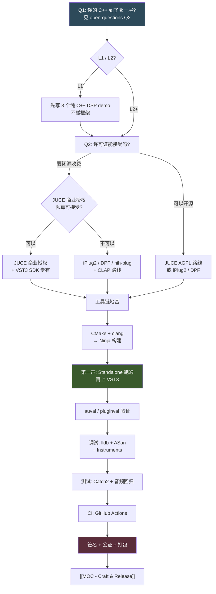

# 🏗️ MOC - Frameworks & Toolchain

**这一页回答"用什么把想法变成能加载的二进制"**：框架、构建系统、调试器、测试、CI、打包。
它夹在 [[MOC - Plugin Formats]]（选什么格式）和 [[MOC - DSP]]（写什么算法）之间，是纯粹的**工程摩擦力**所在。

> [!important] 一句话结论
> 你的路径大概率是 **JUCE + CMake + Xcode/clang + Ninja + GitHub Actions**。
> 但在锁定 JUCE 之前，值得花 30 分钟看一眼 CLAP 生态的框架（iPlug2 / DPF / nih-plug），
> 因为**框架的许可证比框架的功能更容易毁掉一个商业项目**。

> [!note] 这一页的写法
> MOC 是**索引 + 判断**，不是教程。每条链接后的一句话说明"为什么点进去"。
> 未解析的链接是**待写队列**，不是错误。

---

## 依赖与决策顺序



> [!tip] 为什么许可证排在"怎么写代码"前面
> 因为它是**唯一一个事后无法补救**的决策。
> 你可以随时换构建系统、换调试器、换测试框架；
> 但如果你用 AGPL 框架写完了一个闭源插件并已卖出 500 份，你没法"换回来"。

---

## 一、插件框架

### 1.1 C++ 主流

- [[JUCE]] — 事实上的独立开发者默认选择：音频、GUI、插件包装、DSP 模块全包，一份代码出多格式。**本库的核心假设。**
- [[JUCE 的架构与模块划分]] — `juce_core` / `juce_audio_processors` / `juce_dsp` / `juce_gui_basics` 各自负责什么，以及哪些模块你不该链。
- [[Projucer vs CMake]] — JUCE 的两套工程管理方式；**新项目建议 CMake**，Projucer 主要用于生成和查看。
- [[JUCE 的许可证选择]] — AGPLv3 还是商业授权，以及它对插件分发的实际含义。
- [[JUCE 的坑与限制]] — 编译时间、版本升级破坏 API、`juce::dsp` 的性能陷阱等。

### 1.2 其他 C++ 框架

- [[iPlug2]] — 更轻、更接近底层的 C++ 框架，许可证宽松，适合想理解插件底层的人。
- [[DPF (DISTRHO Plugin Framework)]] — 轻量 C++ 框架，原生支持 LV2/VST3/CLAP，Linux 生态友好。
- [[框架对比：JUCE vs iPlug2 vs DPF]] — 学习曲线、许可证、GUI 能力、社区规模的取舍表。

### 1.3 非 C++ / 语言嵌入路线

- [[nih-plug]] — Rust 生态的插件框架；类型安全与内存安全是卖点，但生态和 GUI 选项仍在成长。
- [[Rust 做音频插件的现实评估]] — 值不值得为它放弃 JUCE 的成熟生态。
- [[Faust]] — 函数式 DSP 语言，**写算法不写 C++**，可导出 C++ / JUCE / 插件骨架；做算法原型极快。
- [[Faust 与 JUCE 的集成]] — 用 Faust 生成 DSP、用 JUCE 做外壳与 UI 的混合工作流。
- [[Cmajor]] — 面向实时音频的类 C 语言，强调低延迟与可预测性。
- [[Max/MSP 与 RNBO]] — 图形化打补丁，RNBO 可导出为插件/网页；**原型阶段无敌，产品阶段受限**。
- [[SuperCollider]] — 面向声音合成的语言与服务器架构；适合实验与算法探索。
- [[Pure Data]] — 开源图形化环境，pd 补丁可嵌入插件（libpd）。
- [[Csound]] — 历史悠久的音频编程语言，适合算法教学与传统合成技术。
- [[把脚本语言嵌入插件]] — Lua/JS 做参数与逻辑层，C++ 做 DSP 层。

> [!note] 我的判断：原型语言 vs 交付语言
> **用 Faust / Max / SuperCollider 想清楚"声音对不对"，用 C++ 交付"能不能发布"。**
> 这两件事不要混在一个工具里做。你的音乐人背景让你在原型阶段比 CS 背景的人快得多——
> 那就把这个优势用在算法探索上，别浪费在跟 CMake 搏斗上。

---

## 二、C++ 语言与编译器

- [[C++ 标准的选择]] — C++17 / C++20 在音频项目里的实际差异，以及为什么不用更新标准。
- [[现代 C++ 在音频代码里的禁忌]] — 音频线程上不能做的事：异常、锁、动态分配、`std::function` 的隐藏分配。
- [[编译器：clang vs gcc vs MSVC]] — 三家对音频代码的优化差异与可移植性陷阱。
- [[Apple Silicon 与 x86_64 通用二进制]] — `arm64` / `x86_64` / universal binary 的构建与体积代价。
- [[浮点确定性与 fast-math]] — 为什么 `-ffast-math` 会让你的插件在不同机器上声音不同。
- [[SIMD 与编译器自动向量化]] — 从"等编译器优化"到"自己写 intrinsics"的边界。
- [[编译期计算与模板在 DSP 里的用法]] — 用模板消除运行时分支的实际收益。

---

## 三、构建系统

- [[CMake 基础]] — `target_link_libraries` / `target_compile_definitions` / `target_include_directories` 的现代用法。
- [[CMake 插件项目结构]] — 一个可维护的插件仓库目录长什么样。
- [[JUCE 的 CMake API]] — `juce_add_plugin` 及其一堆参数（`FORMATS`、`PLUGIN_CODE`、`COPY_PLUGIN_AFTER_BUILD`）。
- [[Xcode 与命令行构建]] — 什么时候用 Xcode GUI，什么时候必须回到命令行。
- [[Ninja 与构建速度]] — 为什么 Ninja 比 Make 快，以及怎么和 CMake 配合。
- [[ccache 与编译缓存]] — JUCE 项目编译时间长，缓存是刚需。
- [[依赖管理：CPM / FetchContent / vcpkg]] — 三种拉依赖方式的取舍，以及"该不该 vendor 进仓库"。
- [[构建配置：Debug / Release / RelWithDebInfo]] — 音频插件的 Debug 构建为什么慢到不能用。
- [[交叉编译与多平台构建]] — macOS 上构建 Windows 版本可行吗（大概率不可行，需核实）。

> [!warning] 待验证
> 在 macOS 上直接产出可发布的 Windows 二进制，涉及工具链与 SDK 授权问题，
> 实践中多数人选择用 CI 的 Windows runner 或虚拟机。具体可行方案需核实。

---

## 四、调试与性能剖析

- [[lldb 基础]] — 断点、`po`、`bt`、附加到宿主进程。
- [[调试插件为什么比调试 App 难]] — 宿主进程、扫描阶段崩溃、没有 main 函数、符号加载问题。
- [[Xcode Instruments]] — Time Profiler / Allocations / Leaks 在音频插件上的用法。
- [[AddressSanitizer]] — 抓内存越界与 use-after-free，音频缓冲区越界的头号工具。
- [[ThreadSanitizer]] — 抓数据竞争；**音频线程 bug 的照妖镜**。
- [[UndefinedBehaviorSanitizer]] — 抓有符号溢出、对齐错误等 UB。
- [[Valgrind]] — Linux 生态经典，macOS 上支持受限（需核实当前状况）。
- [[音频线程的实时性检测]] — 怎么发现你的音频回调里偷偷加了锁或分配了内存。
- [[性能剖析：找出真正的瓶颈]] — 先测再优化，以及为什么"看起来慢"的地方往往不是瓶颈。
- [[CPU 占用与宿主报告的差异]] — 宿主显示的 CPU% 为什么和你的测量不一致。

> [!gotcha] 最重要的一条调试经验
> **插件在宿主里崩溃时，第一件事是把同一个二进制当 Standalone 跑。**
> 如果 Standalone 正常、宿主里崩溃，问题通常在宿主交互（参数、状态、线程），
> 而不在你的 DSP。这个分流能省掉大量时间。

---

## 五、测试

- [[单元测试框架选择：Catch2 vs GoogleTest]] — 轻量 vs 生态，以及和 CMake 的集成方式。
- [[DSP 单元测试怎么写]] — 测滤波器系数、测增益、测边界输入，而不是测"听起来对不对"。
- [[音频回归测试]] — 用固定输入生成输出并与 golden file 对比。
- [[Null Test 与 bit-exact 对比]] — 重构后验证"声音一点没变"。
- [[浮点比较的正确方式]] — 为什么不能用 `==` 比较音频样本。
- [[插件合规性测试：pluginval]] — 能在 CI 里跑的跨格式合规检查。
- [[auval 与 AU 验证]] — macOS 上 AU 的官方校验工具。
- [[测量脚本与 Python 工具链]] — 用 Python + numpy/scipy 做频响、THD、噪声底测量。
- [[测试该覆盖到什么程度]] — 一个人开发时的现实取舍。

---

## 六、CI/CD

- [[GitHub Actions 基础]] — workflow / job / step 结构，以及从零配置一个 C++ 项目。
- [[macOS runner 的成本与限制]] — 为什么"每次 push 都跑 macOS 构建"会烧钱，以及怎么省。
- [[CI 里的代码签名]] — 把证书和密钥安全地放进 CI（secrets、base64 导入 keychain）。
- [[CI 里的公证流程]] — `notarytool` 在 CI 中提交与等待结果。
- [[CI 构建矩阵设计]] — Debug/Release × 架构 × 格式，以及如何避免矩阵爆炸。
- [[自建 runner vs 托管 runner]] — 什么时候值得自己养一台 Mac mini。
- [[CI 缓存策略]] — 缓存 JUCE 源码、ccache、依赖，把构建从 20 分钟压到几分钟。

> [!warning] 待验证
> GitHub Actions 的 macOS runner 计费倍率与免费额度**会调整**。
> 本页不记录具体价格，请在准备上 CI 时查当时的官方计费页。

---

## 七、签名、公证、打包、分发

- [[macOS 代码签名]] — Developer ID、Hardened Runtime、entitlements。
- [[macOS 公证 (notarization)]] — `notarytool` 流程与常见拒绝原因。
- [[签名与公证的自动化脚本]] — 把签名→公证→装订（staple）串成一条命令。
- [[Windows 代码签名]] — 与 macOS 完全不同的体系；SmartScreen 信誉积累。
- [[安装包制作：Inno Setup / Packages / DMG]] — Windows 与 macOS 各自的方案选择。
- [[插件安装路径规范]] — VST3 / AU / CLAP / AAX 各自该装到哪，系统级与用户级之别。
- [[版本号与更新分发]] — 语义化版本、更新检查机制、增量更新。
- [[开源仓库结构范例]] — 一个别人愿意 star 的插件仓库长什么样（README、LICENSE、示例、CI 徽章）。

---

## 八、AI 辅助开发（本库的核心假设之一）

> [!important] 这一节为什么单独存在
> 你的目标里明确写了"结合 AI 与 Agent 开发插件"。
> 但**AI 在 C++ 音频项目里的实际效果，和它在 Web/脚本项目里的口碑差距很大**——原因值得写清楚。

- [[AI 辅助 C++ 音频开发的真实效果]] — 哪些任务它很强，哪些任务它会稳定地坑你。
- [[Cursor / Claude Code / Copilot 在 C++ 项目中的对比]] — 上下文理解、大仓库表现、重构能力。
- [[为什么 AI 写不好实时音频代码]] — 它默认写出带锁、带分配、带异常的"教科书 C++"，而那正是音频线程的禁忌。
- [[用 AI 读懂 JUCE 源码]] — 把 AI 当"源码导游"而不是"代码生成器"。
- [[用 Agent 做 DSP 参数搜索]] — 让 Agent 批量跑离线渲染、对比指标、给出候选参数。
- [[用 Agent 做音频回归测试]] — 自动生成测试信号、跑测量、报告差异。
- [[AI 生成代码的审查清单]] — 合并 AI 写的音频代码前必须逐条检查什么。
- [[把知识库喂给 AI]] — 这个 Obsidian 库本身作为 Agent 的上下文源。
- [[本地模型 vs 云端模型]] — 代码隐私、延迟、成本的取舍。

> [!note] 我的判断
> AI 在音频插件开发里的**最佳用法是"测量与解释"，不是"生成"**。
> 让它帮你写测量脚本、解释一段 JUCE 源码、审查实时安全性——回报率极高。
> 让它从零写一个混响算法——你会得到一个能编译、能出声、但声音平庸且可能爆音的东西。
> 你的耳朵是它没有的，别把判断权交出去。

---

## 九、文档与代码质量

- [[Doxygen 与 API 文档]] — 值不值得为个人项目配文档生成。
- [[Markdown 文档与 README 设计]] — 插件项目 README 该写什么（用户最关心安装和兼容性）。
- [[clang-format 与代码风格]] — 自动化格式，避免和 AI 生成的代码风格打架。
- [[clang-tidy 与静态分析]] — 能在编译前抓到的音频代码错误。
- [[代码审查清单（个人项目版）]] — 一个人开发时怎么替代"同事 review"。

---

## 十、🚀 macOS 上从零到第一个能出声的插件：最小步骤清单

> [!important] 目标定义
> **"能出声" = 在 DAW 里加载后，音频能原样通过（或有一个增益旋钮），不崩、不爆音。**
> 不是"做完一个混响"。这一步的唯一目的是**打通整条工具链**，
> 让你确认"构建→安装→宿主扫描→加载→出声"这条链路是通的。

> [!warning] 版本与命令的时效性
> 下面的命令基于通用约定，**具体版本号和参数可能已变化**。
> 每一条都请以官方文档为准；本清单的价值在于**步骤顺序**，不在于逐字照抄。

### 步骤 0：确认你的机器状态

```bash
# 看看有没有构建工具
xcode-select -p          # 应输出 CommandLineTools 或 Xcode 路径
clang++ --version
cmake --version
git --version
```

如果 `xcode-select -p` 报错，先装命令行工具：

```bash
xcode-select --install
```

> [!tip] 需要完整 Xcode 吗
> 只用命令行 + CMake 的话，Command Line Tools 通常够用。
> 但如果你想用 Instruments 做性能剖析、或用 Xcode 调试插件，需要装完整 Xcode（体积很大）。

### 步骤 1：装构建工具

```bash
# 如果没有 Homebrew，先装（见 brew.sh）
brew install cmake ninja ccache
```

### 步骤 2：拿到 JUCE

```bash
mkdir -p ~/dev && cd ~/dev
git clone https://github.com/juce-framework/JUCE.git
cd JUCE && git checkout <某个稳定 tag>   # 别用 master，用发布 tag
```

> [!gotcha] 不要跟着 master 走
> JUCE 的 master 分支 API 会变。**锁定一个 release tag**，
> 否则你今天能编译的代码下周就编译不过，而你会以为是自己写错了。

### 步骤 3：创建最小项目

最小 `CMakeLists.txt` 的骨架（参数名以官方文档为准）：

```cmake
cmake_minimum_required(VERSION 3.22)
project(MyFirstPlugin VERSION 0.1.0)

add_subdirectory(path/to/JUCE)   # 或 FetchContent

juce_add_plugin(MyFirstPlugin
    COMPANY_NAME "YourName"
    PLUGIN_MANUFACTURER_CODE "Yrnm"   # 4 字符，唯一
    PLUGIN_CODE "Mfp1"                # 4 字符，唯一
    FORMATS Standalone VST3 AU
    PRODUCT_NAME "My First Plugin"
    IS_SYNTH FALSE
    NEEDS_MIDI_INPUT FALSE
    NEEDS_MIDI_OUTPUT FALSE
    COPY_PLUGIN_AFTER_BUILD TRUE)

target_sources(MyFirstPlugin PRIVATE Source/PluginProcessor.cpp
                                       Source/PluginEditor.cpp)

target_compile_definitions(MyFirstPlugin PUBLIC
    JUCE_WEB_BROWSER=0
    JUCE_USE_CURL=0
    JUCE_VST3_CAN_REPLACE_VST2=0)

target_link_libraries(MyFirstPlugin PRIVATE
    juce::juce_audio_utils
    juce::juce_dsp
  PUBLIC
    juce::juce_recommended_config_flags
    juce::juce_recommended_lto_flags
    juce::juce_recommended_warning_flags)
```

> [!warning] 待验证
> `PLUGIN_MANUFACTURER_CODE` 和 `PLUGIN_CODE` 必须是**唯一的四字符码**，
> 且 VST3 对字符集有限制。第一次做之前请查 JUCE 文档确认规则——
> 这两个码一旦发布就不该再改，改了会导致老工程找不到插件。

### 步骤 4：配置与构建

```bash
cd ~/dev/my-first-plugin
cmake -B build -G Ninja -DCMAKE_BUILD_TYPE=Release
cmake --build build
```

> [!tip] 为什么先 Release
> Debug 构建的 JUCE 插件在宿主里可能慢到无法使用。
> **调试用 Standalone + Debug，测声音用 Release。**

### 步骤 5：先跑 Standalone，别急着开 DAW

```bash
# COPY_PLUGIN_AFTER_BUILD 会把产物拷到系统插件目录；
# Standalone 通常在 build 目录下可直接运行
open build/MyFirstPlugin_artefacts/Release/Standalone/"My First Plugin.app"
```

> [!important] 这一步是整个清单的关键分流点
> 如果 Standalone 能出声 → 你的 DSP 和构建都没问题，剩下的是宿主交互问题。
> 如果 Standalone 都不出声 → 别去 DAW 里试，先把这里修好。

### 步骤 6：在 DAW 里加载

1. 打开 DAW，让它重新扫描插件（或在设置里手动触发扫描）
2. 新建轨道 → 插入插件 → 找你的插件名
3. 播放音频，确认能通过

如果找不到插件，见 [[插件扫描机制]]；如果是 AU 加载失败，跑：

```bash
auval -a                    # 列出系统里所有 AU
auval -v aufx <subtype> <manufacturer>   # 验证你的 AU
```

### 步骤 7：加一个增益旋钮，验证参数链路

在 `PluginProcessor` 里加一个 `AudioParameterFloat`，在 `processBlock` 里应用它。
**这一步才是真正的验收**——因为它同时验证了：

- 参数能被宿主看见（自动化列表里出现）
- 参数能传到音频线程（旋钮动了声音变了）
- 状态能保存（关掉工程再打开，旋钮位置还在）

> [!gotcha] 最常见的第一个坑
> 旋钮直接乘到音频上会产生 **zipper noise（拉链噪声）**，尤其在快速拖动时。
> 正确做法是参数平滑（smoothed value）。见 [[参数平滑与去拉链]]。

### 步骤 8：验证与签名（发布前）

```bash
# 合规性测试（需先获取 pluginval）
pluginval --strictness-level 10 --validate <你的插件路径>

# 签名与公证（发布时）
codesign --deep --force --options runtime --sign "Developer ID Application: ..." <插件>
# 公证流程见 [[macOS 公证 (notarization)]]
```

### 最小清单速查

| # | 步骤 | 验收标准 | 难度 |
|---|---|---|---|
| 0 | 确认工具链 | `clang++` / `cmake` 有输出 | 🟢 |
| 1 | 装 cmake/ninja | `ninja --version` 有输出 | 🟢 |
| 2 | 克隆 JUCE 并锁 tag | 目录存在且 `git describe` 有 tag | 🟢 |
| 3 | 写 CMakeLists | `cmake -B build` 无报错 | 🟡 |
| 4 | 构建 | 产物出现在 `_artefacts` | 🟡 |
| 5 | **Standalone 出声** | 能听见音频 | 🟢 |
| 6 | DAW 里加载 | 插件出现在列表且不崩 | 🔴 |
| 7 | 增益旋钮 + 平滑 | 旋钮动、声音变、状态存 | 🔴 |
| 8 | pluginval / auval 通过 | 无 error | 🟡 |
| 9 | 签名 + 公证 | 别人机器上能打开 | 🔴 |

> [!note] 预期耗时
> 步骤 0–5 顺利的话是一两个小时；**步骤 6–7 才是真正吃时间的地方**，
> 因为你会第一次遇到"宿主里行为和 Standalone 不一样"这类问题。
> 这是正常的，不是你笨。

---

## 十一、待验证与不确定项

| # | 不确定的内容 | 为什么不确定 | 怎么核实 |
|---|---|---|---|
| 1 | JUCE 当前推荐的 CMake 最低版本 | 随 JUCE 版本变化 | JUCE 仓库的 CMakeLists 与文档 |
| 2 | `juce_add_plugin` 的完整参数列表 | 参数很多且会增删 | JUCE 官方 CMake API 文档 |
| 3 | GitHub Actions macOS runner 计费 | 会调整 | GitHub 官方计费页 |
| 4 | Valgrind 在当前 macOS 上的可用性 | Apple Silicon 支持状况变化 | Valgrind 官方支持说明 |
| 5 | nih-plug / iPlug2 / DPF 的成熟度 | 社区项目演进快 | 各仓库的 release 与 issue 活跃度 |
| 6 | CLAP 在 iPlug2 / DPF 中的支持程度 | 持续开发中 | 各框架 README |
| 7 | 交叉编译 Windows 产物的可行方案 | 涉及工具链与授权 | 社区实践 + 官方文档 |
| 8 | Faust / RNBO 导出插件的工作流细节 | 版本间差异大 | 各自官方文档 |

---

## 相关 MOC

- [[MOC - Plugin Formats]] — 上游：先决定做哪些格式，再决定用什么框架。
- [[MOC - Realtime Engineering]] — 工具链能帮你发现实时性问题（TSan），但契约本身在这一页。
- [[MOC - UI & UX]] — JUCE 的 Component 体系与界面实现。
- [[MOC - DSP]] — 你真正要写的算法；框架只是外壳。
- [[MOC - Craft & Release]] — 发布流程的商业侧。
- [[MOC - AI Audio]] — AI 进插件内部（而非当开发助手）的技术路线。

---

## 待写队列（本领域优先级）

> [!todo] 建议的写作顺序
> 1. [[JUCE]] — 核心，必须先有
> 2. [[JUCE 的 CMake API]] + [[CMake 插件项目结构]] — 每天都要用
> 3. [[调试插件为什么比调试 App 难]] — 省时间的页
> 4. [[JUCE 的许可证选择]] — 商业化的前提
> 5. [[GitHub Actions 基础]] + [[macOS 公证 (notarization)]] — 发布链路
> 6. [[AI 辅助 C++ 音频开发的真实效果]] — 你的核心工作方式
> 7. 其余按需
