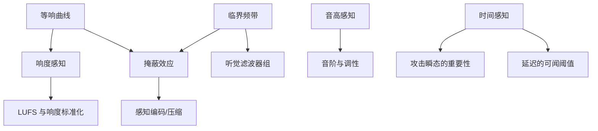

# MOC - Music & Acoustics

> [!important] 这个领域是你的护城河
> 纯 CS 背景的人做插件，技术都对，但**做出来的东西音乐人不想用**。
> 原因几乎总是在这一层：参数范围不对、默认值难听、响应曲线不符合听觉、交互打断创作流。
> 你已经有的这层直觉，是花钱买不到的。**把它写下来，它才能变成代码。**

## 这个领域解决什么

回答"人耳怎么听"，从而决定"算法该怎么设计"。
DSP 告诉你**能算什么**，心理声学告诉你**该算什么**。

## 依赖顺序

## 主题

### 🔴 必学（直接影响插件设计）

- [[等响曲线与频率加权]] — 为什么小音量下低频听起来更少；为什么"响度按钮"存在
- [[掩蔽效应]] — 频域掩蔽与时域掩蔽；EQ 和压缩器设计的心理学依据
- [[临界频带与 Bark 尺度]] — 听觉的频率分辨率不是线性的
- [[响度感知与 LUFS]] — 为什么 peak meter 不能反映响度；ITU-R BS.1770 的思路
- [[时间感知与瞬态]] — 人耳对 attack 的敏感度远高于 release
- [[延迟的可闻阈值]] — 多少 ms 的延迟会被听出来（这决定你的 lookahead 预算）

### 🟠 常用

- [[音高感知]] — 基频缺失现象、虚拟音高，对合成器设计的含义
- [[谐波与泛音列]] — 为什么加法合成听起来"电子"，以及如何让它不那么电子
- [[拍频与失谐]] — 为什么 detune 让声音变宽（以及相位问题）
- [[乐器声学]] — 弦/管/膜的振动模式，物理建模的起点
- [[房间声学基础]] — 早期反射、混响时间 RT60、扩散
- [[立体声感知]] — ILD/ITD、相位 vs 时间差、单声道兼容性
- [[混音惯例]] — 制作人的经验如何翻译成算法参数

### 🟢 进阶

- [[感知编码原理]] — MP3/AAC 的思路，以及它能教给效果器设计什么
- [[听觉场景分析]] — 人耳如何分离声源，对 AI 音频分离的启发
- [[非线性失真感知]] — 什么样的失真"好听"（偶次/奇次、软削波）
- [[音质评价方法]] — MUSHRA、ABX 测试，怎么科学地验证"我的插件更好听"
- [[空间音频]] — Ambisonics、HRTF、双耳渲染

## 制作人 → 工程师 翻译表

| 你的说法 | 工程/心理声学解释 |
|---|---|
| "这个 EQ 很音乐" | 可能是 Q 值随增益变化（动态 Q），或者用了模拟原型的曲线 |
| "压缩器有粘性 glue" | 通常是慢 attack + 程序相关 release + 轻微谐波染色 |
| "听起来很宽" | 可能是 M/S 处理 + 微小延迟差，也可能是 Haas 效应 |
| "这个混响很 3D" | 早期反射密度 + 频变衰减时间 + 调制去相关 |
| "数字味重" | 混叠 / 非线性无过采样 / 相位不自然 |
| "很模拟" | 通常意味着：轻微噪声、偶次谐波、元件容差带来的不一致、频响不完美 |
| "声音糊" | 相位失真、或低频能量掩蔽了中高频细节 |

> [!note] 这张表的作用
> 当你要实现"很模拟"时，这张表告诉你**具体要写什么代码**。
> 「模拟味」不是一个算法，是一组可分解的工程选择。
