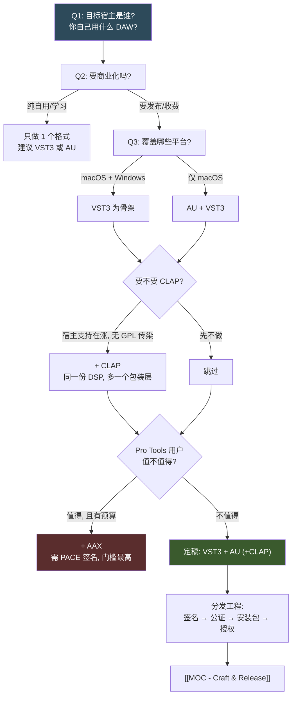

# 🔌 MOC - Plugin Formats

**这个领域决定你的插件"能不能被装进别人的 DAW"**——它是所有技术选型的**上游约束**。
格式选错，后面 DSP 写得再好也跑不起来；格式选对了，同一份 DSP 代码可以同时出 VST3 + AU + CLAP。

> [!important] 读者定位
> macOS 为主力、想发布、可能商业化。所以本页的权重分配是：
> **VST3 / AU 是必选项，CLAP 是加分项，AAX 是"要不要赚 Pro Tools 用户的钱"的生意决策，VST2 是历史包袱。**

> [!note] 这一页的写法
> MOC 是**索引 + 判断**，不是教程。每条链接后面的一句话说明"为什么点进去"。
> 大量链接指向尚未存在的页面——那是**待写队列**，不是错误（见 [[_meta/taxonomy|命名规范]]）。

---

## 依赖与决策顺序

> [!tip] 顺序为什么是这样
> 先问**宿主**（决定格式），再问**商业**（决定要不要签名/授权），最后问**平台**（决定构建矩阵）。
> 反过来做（先学 AAX 或先研究防破解）是最常见的浪费时间方式。

---

## 一、格式全景

### 1.1 主流格式

- [[VST3]] — Steinberg 的当代标准，跨平台事实默认值；SDK 采用 **GPLv3 / 专有双授权**，是许可证陷阱的重灾区。
- [[VST2 的淘汰现状]] — 已停止发放新授权、SDK 不再分发；但存量宿主与老工程仍需要它，理解"为什么还有人做"。
- [[Audio Units (AU)]] — Apple 的 Core Audio 原生格式，macOS 上延迟与集成度最好；**只能在 macOS 构建和测试**。
- [[AUv3]] — 基于 App Extension 的新一代 AU，iOS/iPadOS 的唯一正路，沙盒化带来一系列架构约束。
- [[CLAP]] — 开源、Bitwig + u-he 发起的后起格式；线程池、per-note 调制、**无 GPL 传染**是它的三个卖点。
- [[AAX]] — Avid Pro Tools 的唯一格式；必须经 **PACE 签名**才能加载，是"商业决策"而非"技术决策"。
- [[LV2]] — Linux 生态的主力格式，插件元数据用 Turtle 描述；macOS/Windows 上基本可以不考虑。
- [[Standalone 独立应用]] — 不带宿主的可执行版本，调试期价值极高，也是"非 DAW 用户"的分发形态。
- [[Web Audio 与 AudioWorklet]] — 浏览器内音频；不是 DAW 插件格式，但对"零安装试听 demo"和网页工具极有价值。

### 1.2 格式元知识

- [[插件格式的抽象层]] — 为什么 JUCE/iPlug2 能用一份代码出多个格式，以及这层抽象漏了什么。
- [[插件格式能力对比表]] — 一张表看清自动化精度、多通道、note expression、sandbox 等差异。
- [[宿主兼容性矩阵]] — Ableton / Logic / Reaper / Bitwig / FL / Cubase / Pro Tools 各自认哪些格式。
- [[插件格式的历史脉络]] — VST→AU→AAX→CLAP 每一代解决的是什么痛点，看懂这个就不会被新格式炒作带走。
- [[格式的迁移成本]] — 从"只做 VST3"扩到多格式，实际要改多少代码。

---

## 二、格式能力对比

> [!warning] 待验证
> 下表的**结构性差异**（有没有某个能力）可信度较高，但**具体数值和细节**（如最大通道数、自动化精度上限）
> 会随 SDK 版本变化。落笔实现前请以官方文档为准，不要以本表为依据。

| 维度 | VST3 | AU (v2) | AUv3 | CLAP | AAX |
|---|---|---|---|---|---|
| 平台 | macOS / Win / Linux | macOS only | macOS / iOS | macOS / Win / Linux | macOS / Win |
| 多通道 / 环绕 | 支持 | 支持 | 支持 | 支持 | 支持 |
| 采样精确自动化 | 支持 | 部分 | 部分 | 支持 | 支持 |
| 多插件打包进一个二进制 | 支持（同一次扫描多个 class） | 否（一个组件一个类型） | 随 App 分发 | 支持 | 否 |
| per-note / 复音调制 | Note Expression | 有限 | 有限 | 一等公民（per-voice） | 有限 |
| 多线程处理 | 宿主调度为主 | 宿主调度 | 宿主调度 | 插件自带 thread pool | 宿主调度 |
| 开源许可 | GPLv3 或专有 | Apple SDK 条款 | Apple SDK 条款 | 开源（宽松型，需核实具体条款） | 专有 + 签名 |
| 需要代码签名 | 建议 | 建议 | 必需（App Store 则强制） | 建议 | **必需（PACE）** |
| 入门门槛 | 中 | 中（但仅限 mac） | 中高（要懂 App Extension） | 中 | 高 |

<!-- derived -->
推导链：格式的平台限制来自各 SDK 的目标平台；"必需签名"一列来自各宿主/商店的加载要求
（AAX 由 PACE 机制强制、AUv3 由 App Store 沙盒强制），其余为建议性签名。

---

## 三、宿主兼容性矩阵

> [!warning] 待验证
> 宿主支持情况**变化很快**（CLAP 尤其），本表只是决策起点。
> 做正式决定前，去各宿主官网的支持格式列表核实一遍。

| 宿主 | VST3 | VST2 | AU | AUv3 | CLAP | AAX |
|---|---|---|---|---|---|---|
| Ableton Live | ✅ | ✅ | ✅ (mac) | ⚠️ 需核实 | ❌ 需核实 | ❌ |
| Logic Pro | ❌ | ❌ | ✅ | ⚠️ 需核实 | ❌ | ❌ |
| Reaper | ✅ | ✅ | ✅ (mac) | ⚠️ 需核实 | ✅ | ❌ |
| Bitwig Studio | ✅ | ✅ | ✅ (mac) | ⚠️ 需核实 | ✅（早期支持者） | ❌ |
| FL Studio | ✅ | ✅ | ✅ (mac) | ⚠️ 需核实 | ⚠️ 需核实 | ❌ |
| Cubase / Nuendo | ✅ | ✅（旧版） | ❌ | ❌ | ❌ | ❌ |
| Pro Tools | ❌ | ❌ | ❌ | ❌ | ❌ | ✅ |

> [!note] 从这张表读出的三个结论
> 1. **没有任何单一格式能覆盖全部宿主**——Logic 只认 AU，Pro Tools 只认 AAX，这是硬约束。
> 2. **VST3 + AU 已经覆盖绝大多数 macOS 用户**（Ableton / Logic / Reaper / Bitwig / FL / Cubase）。
> 3. **CLAP 是"锦上添花"而非"入场券"**——不做 CLAP 不会让你损失多少用户，但做了能拿到 Bitwig/Reaper 社区的口碑。

- [[宿主兼容性测试流程]] — 怎么系统性地在每个宿主里过一遍，而不是"在我这台能跑就行"。
- [[Logic 与 AU 的特殊要求]] — Logic 对 AU 的验证（validation）比谁都严格。
- [[Pro Tools 生态的门槛]] — AAX 的商务门槛为什么比技术门槛更高。

---

## 四、插件类别与参数系统

### 4.1 类别

- [[Effect 效果器插件]] — 最常见的一类，输入音频→输出音频；总线/插入两种用法带来不同约束。
- [[Instrument 乐器插件]] — 要处理 MIDI、复音、voice 分配，复杂度显著高于效果器。
- [[Analyzer 分析器插件]] — 只读不改（或只输出分析数据），常常需要和 UI 线程共享数据。
- [[MIDI Effect 插件]] — 只处理 MIDI 不碰音频；各格式对它的支持程度差异很大。
- [[插件类别的格式差异]] — 同一个概念在不同格式里的名字和声明方式都不一样（AU 的 `aufx`/`aumu`/`augx` 等类型标识）。

> [!note] AU 的类型标识（type/subtype/manufacturer）
> AU 用四个字符的 `type` 区分类别，例如 `aufx`（效果器）、`aumu`（乐器）、`augx`（发生器）。
> 这四个字符会出现在 `auval` 的输出里，是排查 AU 加载失败的第一手线索。
> 完整类型列表与 `subtype`/`manufacturer` 的命名规则：见 [[AU 的四字符标识]]。

### 4.2 参数与自动化

- [[参数系统与自动化]] — 宿主怎么"看见"你的参数，以及为什么参数 ID 一旦发布就不能改。
- [[参数 ID 与版本兼容]] — 改动参数顺序会让老工程里的自动化错位，这是最典型的发布事故。
- [[Sample-accurate 自动化]] — 参数在一个 buffer 中间变化意味着什么，以及怎么正确响应。
- [[参数平滑与去拉链]] — 参数突变产生的 zipper noise（拉链噪声），是"听起来很业余"的头号原因。
- [[参数的单位与范围]] — dB / Hz / % / 0–10 的选择如何影响宿主里的显示和自动化曲线。
- [[Bypass 与 A-B 的正确实现]] — bypass 不是"跳过处理"那么简单，延迟补偿会出卖你。

---

## 五、预设与状态

- [[预设格式概览]] — VST3 preset / `.aupreset` / CLAP preset 的差异与互通性。
- [[插件状态序列化]] — `getStateInformation` / `setStateInformation` 这一对函数是**兼容性的生死线**。
- [[状态版本迁移]] — 老版本工程在新版插件里打开时，怎么不炸。
- [[预设浏览器与出厂预设]] — 预设放哪、怎么随安装包分发、怎么让宿主能搜到。
- [[参数与预设的边界]] — 哪些东西该进参数（宿主可见），哪些该进状态（宿主不可见）。

---

## 六、MIDI 2.0 与 MPE

- [[MPE (MIDI Polyphonic Expression)]] — 用"每音符一个通道"实现复音弯音/压力，是现代合成器插件的标配能力。
- [[MIDI 2.0 与 UMP]] — 更高分辨率、per-note controller、Property Exchange、Capability Inquiry。
- [[MPE 在 JUCE 里的支持]] — `MPEInstrument` / `MPEMessages` 这一套类怎么用。
- [[格式对 MPE 的支持差异]] — 哪些格式能原生承载 MPE，哪些要靠通道 hack。

> [!warning] 待验证
> MIDI 2.0 的**宿主侧支持**目前仍不完整，各 DAW 落地程度差异很大。
> 现在为 MIDI 2.0 做架构投入的回报不确定，建议先保证 MPE 可用。

---

## 七、验证、扫描与测试工具

- [[auval 与 AU 验证]] — Apple 自带的 AU 校验工具；AU 装不上时第一个要跑的命令。
- [[pluginval]] — 跨格式的插件合规性测试工具，能在 CI 里跑，是发布前的守门员。
- [[插件扫描机制]] — 宿主怎么发现插件、为什么会"扫不到"、扫描崩溃是谁的锅。
- [[插件沙盒与崩溃隔离]] — 现代宿主的 out-of-process 加载，以及它如何改变你的调试方式。
- [[音频回归测试]] — 用脉冲响应/白噪声对比 golden file，防止重构改坏声音。
- [[Null Test 与 bit-exact 对比]] — 判断"改了代码后声音是否完全没变"的最硬证据。

---

## 八、分发工程：签名、公证、安装

> [!important] 这一节是"能跑"和"能给别人装"的分界线
> 很多人的插件在自己机器上完美运行，发给别人就报"已损坏，无法打开"。
> 原因几乎总是签名/公证/隔离属性（quarantine）三件事之一。

- [[macOS 代码签名]] — Developer ID、Hardened Runtime、entitlements；为什么插件也需要签名。
- [[macOS 公证 (notarization)]] — 公证不是签名；`notarytool` 提交流程与常见拒绝原因。
- [[Gatekeeper 与 quarantine 属性]] — 用户下载后打不开的真实机制，以及 `xattr` 的应急手段。
- [[Windows 代码签名]] — 与 macOS 完全不同的体系；EV 证书与 SmartScreen 信誉。
- [[Windows 安装包制作]] — Inno Setup / NSIS 等方案的选择与插件路径写入。
- [[macOS 安装包制作]] — `.pkg`（Packages）与 `.dmg` 的取舍，以及多格式一次安装。
- [[插件安装路径规范]] — VST3 / AU / CLAP / AAX 各自该装到哪里（系统级 vs 用户级）。
- [[卸载与残留清理]] — 用户卸载不干净是差评的常见来源。
- [[版本号与更新分发]] — 语义化版本、更新检查、增量更新。

---

## 九、授权与防破解

- [[iLok 与 PACE 体系]] — 硬件狗 / 软授权 / 机器绑定，以及它对**用户好感度**的代价。
- [[序列号授权方案]] — 最轻量的方案，以及它为什么几乎必然被破解。
- [[授权方案的技术对比]] — 自研 / 商业 SDK / 平台商店内购的取舍。
- [[离线激活与联网激活]] — 用户体验与防破解强度的直接冲突点。
- [[试用版与 Demo 限制]] — 白噪声、静音、时限三种策略的实际效果差异。
- [[防破解的现实预期]] — 为什么"防不住"是常态，以及预算该花在哪。

> [!note] 我的判断
> 对独立开发者，**授权系统的投入产出比通常很差**。
> 把同样的时间花在"让插件更好用"上，往往比花在"让插件更难破解"上赚得多。
> 除非你做的是高价专业工具（那才需要 iLok 这类"专业感"背书）。

---

## 十、许可证陷阱（最容易被忽略、后果最严重）

> [!danger] 这一节请逐条读完再选框架
> 许可证问题**不会在开发期暴露**，只会在你准备收费/闭源的那一刻爆炸。

- [[VST3 SDK 的双授权]] — GPLv3 与 Steinberg 专有许可二选一；选 GPL 意味着你的插件也必须 GPL。
- [[JUCE 的授权模式]] — AGPLv3 与商业授权的双轨；AGPL 对"闭源商业插件"意味着什么。
- [[AGPL 与插件的关系]] — AGPL 的网络条款对本地插件是否适用，是社区长期争论点。
- [[GPL 传染性与静态链接]] — 为什么"我只是链接了一下"在法律上并不轻。
- [[CLAP 的许可证优势]] — 宽松许可意味着你可以闭源收费而无需购买任何商业授权。
- [[框架许可与插件格式许可的叠加]] — JUCE(AGPL) + VST3 SDK(GPL) 同时使用时会发生什么。
- [[开源我的插件：许可证怎么选]] — 如果你决定开源，MIT / GPL / AGPL 的后果差异。

> [!warning] 待验证
> JUCE 的授权条款在近期大版本中**有过调整**（引入了按营收分层的档位）。
> 具体门槛金额、免费额度、以及是否仍提供一次性买断——**请以官网当前条款为准**，
> 本页不记录具体数字，因为记了就一定会过期。

---

## 十一、🎯 格式选择决策树

**场景**：macOS 为主力、想发布、可能商业化、一个人开发、目标是尽快做出第一个能用的插件。

### 结论先行

> [!important] 推荐路径
> **VST3 起步 → 加 AU → 视情况加 CLAP → AAX 最后考虑 → VST2 不做。**

理由不是"VST3 最好"，而是**它是唯一同时满足"跨平台"+"覆盖宿主最多"+"资料最多"三个条件的格式**。

### 逐格式判断

| 格式 | 现在做? | 理由 |
|---|---|---|
| **VST3** | ✅ **第一个做** | 跨平台；Ableton/Cubase/Reaper/Bitwig/FL 都认；社区资料和排错经验最多；JUCE 原生支持。缺点：SDK 许可证需要你做个决定。 |
| **AU** | ✅ **第二个做** | 你在 macOS 上，不做 AU 就等于放弃 Logic 用户——而 Logic 是 macOS 上装机量最大的 DAW。JUCE 里几乎是"勾一个选项"的成本。 |
| **CLAP** | 🟡 **有余力就做** | 无 GPL 传染（可能让你省下商业授权费）；技术设计更现代；但宿主覆盖率有限，且是**第三个包装层**，先别急着做。 |
| **Standalone** | ✅ **开发期就开** | 不是发布格式，而是**调试利器**——不用开 DAW 就能测，还能给非 DAW 用户试听。JUCE 里成本极低。 |
| **AUv3** | 🟡 **想做 iOS 再说** | macOS 上 Logic 对 AUv3 的支持在增长，但沙盒化会改变你的架构（文件访问、进程边界）。别在第一个项目碰。 |
| **AAX** | ❌ **暂时不做** | 门槛最高：Avid 开发者账号 + PACE 签名 + 可能的费用 + 独立的测试环境。**这是生意决策**：先问"Pro Tools 用户占我目标用户多少"。 |
| **VST2** | ❌ **不做** | 已停止发放新授权。除非你要支持某个只认 VST2 的老宿主/老用户群。 |
| **LV2** | ❌ **不做** | 除非你明确要进 Linux 发行版仓库。 |
| **Web Audio** | 🟡 **另开一条线** | 和 DAW 插件是两套技术栈，不要试图共用代码。但适合做"网页试听 demo"降低试用门槛。 |

### 为什么不是"全都要"

<!-- derived -->
推导链：多格式的成本不是线性叠加，而是**每增加一个格式就多一条测试矩阵**。
你只有一个人，测试矩阵宽度直接决定你能多快发布。

每多一个格式，你要多测：安装路径、宿主扫描、参数自动化、状态保存/恢复、离线导出（bounce）、
多采样率、多 buffer size、Apple Silicon 与 Intel。**5 个格式 = 5 倍验证工作量**，
而 CLAP/AAX 带来的增量用户可能不到 10%。

> [!tip] 更聪明的顺序
> 先把 **VST3 一个格式做扎实**（参数、状态、自动化、UI 都对），
> 因为 JUCE 的架构下，**加 AU/CLAP 主要是构建配置的改动，而不是重写**。
> 反过来，如果一开始就铺开五个格式，你会在"每个格式都有 bug"的状态里卡很久。

---

## 十二、待验证与不确定项

| # | 不确定的内容 | 为什么不确定 | 怎么核实 |
|---|---|---|---|
| 1 | CLAP 的确切许可证条款 | 记忆中的宽松许可，未查证 | 看 CLAP 仓库的 LICENSE 文件 |
| 2 | 各宿主对 CLAP / AUv3 的支持现状 | 变化快，且随版本更新 | 各宿主官网格式支持页 |
| 3 | VST2 授权停止的确切时间点 | 只记得大致时期 | Steinberg 官方公告 |
| 4 | JUCE 当前的授权分层与免费额度 | 近期调整过 | JUCE 官网 pricing 页 |
| 5 | AAX 的开发者门槛是否涉及费用 | 印象中有，未确认金额与形式 | Avid 开发者页面 |
| 6 | AU 四字符类型的完整清单 | 只确信常用的几个 | Apple Core Audio 文档 |
| 7 | VST3 SDK 专有许可的具体限制条款 | 只知有双授权，未读全文 | Steinberg VST3 SDK 许可页 |
| 8 | 各格式的自动化精度上限 | 结构性差异可信，数值不可信 | 各 SDK 文档 |

> [!warning] 使用本页的正确姿势
> 把这一页当**决策框架和待办清单**，不要当**事实数据库**。
> 上表每一行都是一个具体的"去查一下"的任务。

---

## 相关 MOC

- [[MOC - Frameworks & Toolchain]] — 选定格式之后，用什么框架和构建系统去实现。
- [[MOC - Craft & Release]] — 签名、公证、定价、授权、客服的完整发布流程。
- [[MOC - Realtime Engineering]] — 格式只是外壳，音频线程契约才是插件不崩的根本。
- [[MOC - UI & UX]] — 宿主窗口、参数绑定、缩放等与格式强相关的界面约束。
- [[MOC - DSP]] — 格式无关的核心：你真正要写的音频算法。

---

## 待写队列（本领域优先级）

> [!todo] 建议的写作顺序
> 1. [[VST3]] — 最高频，先有骨架
> 2. [[Audio Units (AU)]] — macOS 必需
> 3. [[参数系统与自动化]] — 跨格式通用，写一次到处引用
> 4. [[插件状态序列化]] — 兼容性生死线
> 5. [[macOS 代码签名]] + [[macOS 公证 (notarization)]] — 发布必踩
> 6. [[CLAP]] — 想清楚后再写
> 7. 其余按需
