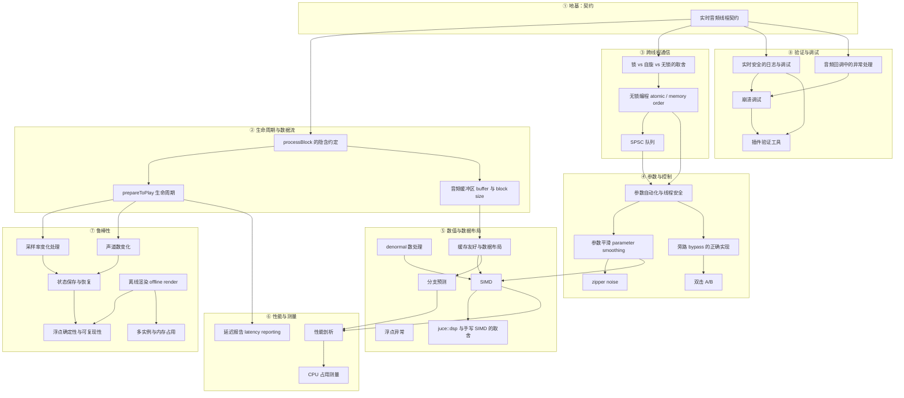

# ⚡ MOC - Realtime Engineering（实时音频工程）

> 本页是**索引**，不是教程。它只回答两个问题：**「我现在该学什么」**和**「这个概念该放在哪」**。
> 下面大量链接指向还不存在的页面——这是**故意的**，它们就是待写队列。Obsidian 会把它们显示为未解析链接。

## 这个领域解决什么问题

DSP 决定插件**好不好听**，实时工程决定插件**能不能用**。

实时音频线程有一个残酷的约束：它必须在**每个缓冲周期内**完成所有工作，而周期长度由宿主和采样率决定——在 48 kHz、128 samples 的 buffer 下，你的预算是 **2.67 ms**。超时的后果不是"变慢"，而是**爆音、丢帧、宿主判定插件不合格**。

> [!important] 这个领域最反直觉的一点
> 大部分 DSP 教材教你"怎么算得对"，实时工程教你"**怎么在不能等待、不能分配、不能阻塞的前提下算得对**"。
> 同样的算法，写在离线脚本里和写在 `processBlock` 里，是两件完全不同的事。
> 这也是为什么你的 CS 背景在这里**既是优势也是陷阱**——你熟悉的很多标准做法（锁、动态分配、异常、日志）在音频线程里全是禁忌。

---

## 知识依赖顺序

箭头 = **「不先懂 A，B 就只能死记硬背」**。这组依赖比 DSP 更陡：最上面的契约不理解，下面的技巧全是空中楼阁。



### 最小主线（如果只想先跑通一条路）

```
实时音频线程契约 → processBlock 的隐含约定 → prepareToPlay 生命周期 → 无锁编程 → SPSC 队列 → 参数平滑
```

走完这条线，你已经能写出**不会因为线程问题崩溃、参数拖动不爆音**的插件。这是所有后续优化的前提。

---

## 💥 新手插件崩溃的 Top 5 原因

> [!warning] 这是判断，不是统计
> 下面这份排名**来自常见故障模式的归纳**，不是对崩溃日志的量化统计，也没有引用具体调查数据。
> 把它当作**排查优先级**来用，不要当作结论引用。

| # | 症状 | 根因 | 为什么难查 | 怎么防 |
|---|---|---|---|---|
| 1 | 偶发爆音、卡顿，CPU 突然飙到 100%，严重时宿主直接判定插件超时 | 在音频线程里做了**分配内存 / 加锁 / 文件或网络 IO**：`std::vector::push_back`、`std::string`、`new`、`mutex`、`printf` | 大部分时候**不崩**。只在特定 buffer 大小、特定宿主的线程调度下暴露，本地怎么点都复现不出来 | [[实时音频线程契约]]：所有资源在 [[prepareToPlay 生命周期]] 里备好，音频线程只读写预先分配的缓冲区 |
| 2 | 一加载就崩、随机越界、release 下正常但 debug 下报错 | `processBlock` 里假设了错误的 **block size 或声道数**：写死 512、假设 stereo、没处理 `numSamples == 0` | 你的宿主给的 block size 恰好等于你的假设，换个宿主或改设置就炸 | [[音频缓冲区 buffer 与 block size]]：只用传入的 `numSamples` / 声道数，绝不假设 |
| 3 | 改采样率或切单声道后声音错乱、滤波器发散、出现 NaN | 采样率/声道数变化后**没重新计算系数或重分配缓冲** | 系数是"算过一次就一直用"的隐式状态，改设置时没人提醒你 | [[采样率变化处理]] + [[声道数变化]]：`prepareToPlay` 会被反复调用，把它当成唯一的初始化入口 |
| 4 | CPU 占用高得离谱，但不崩，只是带不动 | 没处理 [[denormal 数处理]]：反馈路径（混响、滤波器）里的极小值触发 CPU 的慢速路径 | 表现是"性能问题"不是"错误"，你会在优化算法上白花很多时间 | 在反馈路径末端加极小直流偏置，或启用 flush-to-zero |
| 5 | 拖动参数时爆音/咔哒声，或撤销/重开后状态丢失、UI 与声音不一致 | **跨线程直接读写 DSP 参数**（数据竞争），或 [[状态保存与恢复]] 没覆盖全部参数 | 竞争是概率性的；状态问题只在宿主恢复工程时暴露 | [[参数自动化与线程安全]] + [[参数平滑 parameter smoothing]] + [[状态保存与恢复]] |

> [!tip] 如果只能记一条
> **音频线程里不能等待。** 第 1 条是它的直接违反，第 2/3/5 条则是同一个根源的另一面：
> **把音频线程当成了普通线程**——随便假设、随便初始化、随便共享变量。
> 遇到任何诡异问题，先问两句话：
> ① 这一行会不会分配、加锁、或阻塞？② 这个状态是谁、在哪个线程、什么时候建的？

---

## 主题清单

难度用 ★ 表示（★=入门，★★★★★=需要经验积累）；优先级用 🔴必学 / 🟠常用 / 🟢进阶。

### ① 实时音频线程契约 — 🔴 必学 · 难度 ★★

> 这一组是整个领域的**宪法**。其余所有条目都是它的推论。

- [[实时音频线程契约]] — no allocation / no lock / no IO 三条铁律，以及每条背后的原因（不是教条，是硬约束）
- [[音频回调中的异常处理]] — 为什么 `processBlock` 里不该让异常逃出去，以及出错时该怎么收场
- [[浮点异常]] — NaN / Inf 的产生与传播；为什么一个 NaN 会污染整条信号链并永不消失

### ② 生命周期与数据流 — 🔴 必学 · 难度 ★★

- [[processBlock 的隐含约定]] — 这个函数被调用时宿主保证了什么、又**没有**保证什么。最容易踩的隐性假设都在这
- [[音频缓冲区 buffer 与 block size]] — buffer 的所有权、连续性、声道布局，以及 block size 会变的这件事
- [[prepareToPlay 生命周期]] — 唯一的初始化入口。会被反复调用，所以它必须是幂等的
- [[延迟报告 latency reporting]] — 怎么向宿主申报延迟，以及申报错误会带来什么后果（录音对齐、延迟补偿）
- [[采样率变化处理]] — 用户改采样率时会发生什么，哪些状态必须重算
- [[声道数变化]] — 单声道/立体声切换、非活动声道、以及"输入和输出声道数不一样"的情况

### ③ 跨线程通信 — 🔴 必学 · 难度 ★★★★

- [[锁 vs 自旋 vs 无锁的取舍]] — 三种方案的代价模型。重点不是"无锁更快"，而是"为什么锁在这里不可接受"
- [[无锁编程 atomic / memory order]] — `std::atomic` 与内存序。理解 release/acquire 是写对无锁代码的最低门槛
- [[SPSC 队列]] — 单生产者单消费者队列：UI 线程到音频线程传消息的标准答案，也是最值得手写一遍的数据结构

### ④ 参数与控制 — 🔴 必学 · 难度 ★★★

- [[参数自动化与线程安全]] — 宿主自动化、UI 拖动、预设加载三条写入路径同时存在时怎么保证一致
- [[参数平滑 parameter smoothing]] — 为什么参数不能逐样本突变；一阶平滑、线性斜坡、S 曲线的取舍
- [[zipper noise]] — 参数阶跃产生的咔哒声，它的成因和听感特征
- [[旁路 bypass 的正确实现]] — 真正的 bypass 不只是"跳过处理"：要处理延迟、状态残留和电平匹配
- [[双击 A/B]] — 对比功能的实现要点：状态切换要无爆音，比较才有效

### ⑤ 数值与数据布局 — 🟠 常用 · 难度 ★★★

- [[denormal 数处理]] — 反馈结构里几乎必然遇到的问题，处理方式与副作用
- [[SIMD]] — SSE / AVX / NEON 的基本模型，以及编译器的自动向量化能帮你到哪一步
- [[juce::dsp 与手写 SIMD 的取舍]] — 什么时候用框架的封装、什么时候值得手写。这是取舍不是信仰
- [[缓存友好与数据布局]] — AoS 与 SoA 的选择、访问顺序、以及为什么内存带宽常比浮点算力更早成为瓶颈
- [[分支预测]] — 音频处理里的分支代价；为什么"逐样本 if"是性能杀手，以及怎么改写成无分支形式

### ⑥ 性能与测量 — 🟠 常用 · 难度 ★★★

> [!note] 先测量，再优化
> 这一组的存在意义是**防止你优化错地方**。没有测量的优化是猜谜。

- [[性能剖析]] — Instruments / perf / Tracy 的用法与适用场景：采样型与插桩型剖析器各能回答什么问题
- [[CPU 占用测量]] — 怎么测才和宿主的读数对得上；为什么"任务管理器里的百分比"会误导你

### ⑦ 鲁棒性与可复现 — 🟠 常用 · 难度 ★★★

- [[状态保存与恢复]] — `getStateInformation` / `setStateInformation` 的完整实现：版本迁移、参数之外的状态、向后兼容
- [[离线渲染 offline render]] — 比实时更快的渲染路径。它和实时路径的差异在哪，以及为什么不能假设两者等价
- [[多实例与内存占用]] — 一个工程里开 30 个实例时，什么会被放大 30 倍，什么应该共享
- [[浮点确定性与可复现性]] — 同样的输入为什么两次渲染结果可能不同：编译器优化、SIMD 归约顺序、FTZ 设置

### ⑧ 验证与调试 — 🔴 必学 · 难度 ★★★

- [[插件验证工具]] — pluginval / auval / vst3 validator 各查什么、不查什么。**这是你提交前的最后一道闸**
- [[崩溃调试]] — lldb / AddressSanitizer / ThreadSanitizer：分别能抓到内存错误、数据竞争、还是死锁
- [[实时安全的日志与调试]] — 怎么在不违反实时契约的前提下留下可诊断的痕迹；断点和 `printf` 为什么在音频线程里危险

---

> [!note] 关于本页的 `sources: []`
> MOC 是索引，它声明的是**结构与范围**，不是事实性结论，所以不带来源。
> 但由它指向的**每一个主题页都必须遵守溯源规则**（见 [[AGENTS]] §3）——公认常识免标注，其余要来源或 `> [!warning] 未验证`。

> [!warning] 未验证：本页的优先级、难度评级与 Top 5 排名
> 这些是**基于常见插件开发路径的判断**，不是从资料推导或统计得出的结论。
> 尤其是 Top 5 的**排序**，会随你的宿主、平台和插件类型变化。

> [!note] 与相邻 MOC 的边界
> - 算法的**数学与结构**（滤波器、混响、非线性）→ [[MOC - DSP]]
> - 这些约束**在 JUCE 里具体怎么写** → [[MOC - Frameworks & Toolchain]]
> - 插件格式规范带来的额外约束（VST3 的 `process`、AU 的渲染回调）→ [[MOC - Plugin Formats]]
> - 参数该暴露给用户什么 → [[MOC - UI & UX]]

## 相关

- [[MOC - DSP]] — 前置：你要实时跑起来的算法本身
- [[MOC - Plugin Formats]] — 宿主与格式规范带来的额外约束
- [[MOC - Frameworks & Toolchain]] — JUCE、构建、签名、CI
- [[Home]] — 知识库入口
