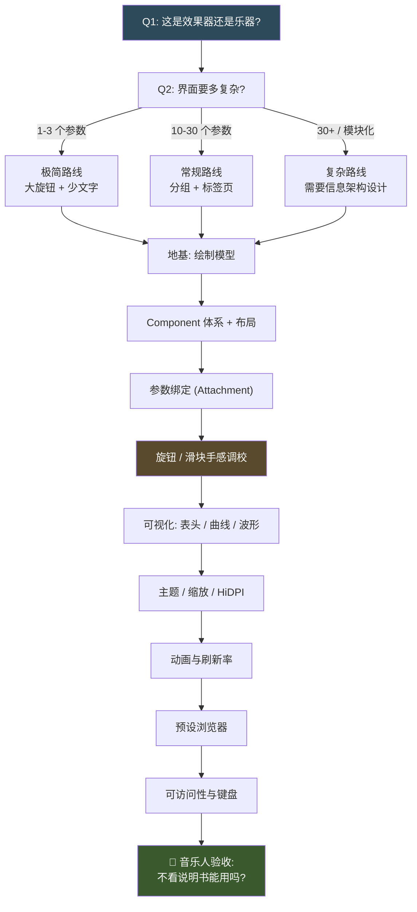

# 🎨 MOC - UI & UX

**这一页是你在整个知识库里最有话语权的地方。**
DSP 算法你可以学，CMake 你可以查文档，但"什么样的界面让音乐人愿意用"——
这件事你比大多数写插件的人更懂，因为你曾经是坐在另一端的人。

> [!important] 界面不是装饰，是产品
> 音乐人选插件时**先看界面**，很多时候还没听声音就决定了要不要试。
> 一个参数设计糟糕的插件，哪怕 DSP 是教科书级的，也会被卸载。
> 反过来，一个 DSP 平庸但"手感对"的插件能卖得很好。这不公平，但这是事实。

> [!note] 这一页的写法
> MOC 是**索引 + 判断**，不是教程。未解析的链接是**待写队列**，不是错误。

---

## 依赖与决策顺序

> [!tip] 顺序的意义
> 大多数人的错误是**从可视化开始**（先写个漂亮的频谱仪），
> 而真正的顺序是**先把参数绑定的手感做对**。
> 用户 90% 的交互时间花在拖旋钮上，不是盯着频谱看。

---

## 一、绘制模型与渲染基础

- [[插件 GUI 的绘制模型]] — OpenGL vs 软件渲染 vs 平台原生，各自的延迟、兼容性、CPU 占用取舍。
- [[JUCE 的渲染后端选择]] — 什么时候值得开 OpenGL，以及它在某些宿主里的已知问题。
- [[GUI 线程 vs 音频线程]] — 两个线程的边界；所有界面问题的根源都在这里。
- [[repaint 与脏矩形]] — 为什么"整个界面重绘"会让 CPU 爆掉。
- [[帧率与刷新同步]] — `Timer` 驱动的刷新 vs `vblank` 同步，以及为什么 60fps 不是越高越好。
- [[GUI 性能剖析]] — 界面卡顿是画得慢还是逻辑慢，怎么区分。

> [!gotcha] 最常见的界面性能错误
> 在 `paint()` 里做**分配、字符串拼接、文件读取、或调用音频线程**。
> `paint()` 每秒会被调用几十次，任何"稍微重一点"的操作都会累积成卡顿。
> 更糟的是，如果它间接阻塞在音频线程的锁上，你会同时毁掉声音。

---

## 二、JUCE 界面体系

- [[JUCE Component 体系]] — `Component` / `parent` / `child` 树、`bounds`、`z-order`、生命周期。
- [[Component 的所有权与生命周期]] — 谁 delete 谁；`unique_ptr` 与 `addAndMakeVisible` 的关系。
- [[Resized 与布局]] — `resized()` 是唯一该放布局代码的地方。
- [[JUCE 的 LookAndFeel]] — 全局换肤机制，以及为什么它既是福音也是陷阱。
- [[自定义 LookAndFeel 与绘制]] — 从改颜色到完全自绘控件。
- [[JUCE 的 Slider 与旋钮]] — `RotaryHorizontalVerticalDrag` 等样式与手感参数。
- [[juce::Attach 与参数绑定]] — `SliderAttachment` / `ButtonAttachment` / `ComboBoxAttachment` 的正确用法。
- [[Attachment 的生命周期陷阱]] — 控件销毁顺序不对导致的崩溃，是 JUCE 新手最常见的 bug。
- [[不用 Attachment 手动绑定参数]] — 需要自定义行为时怎么做，以及要自己处理什么。
- [[JUCE 的 OpenGL 上下文]] — `OpenGLContext` 的附加与 detach 时机。

### 2.1 第三方 UI 库与替代方案

- [[第三方 UI 库概览]] — 什么时候该跳出 JUCE 自带控件，什么时候跳出去是自找麻烦。
- [[ImGui 在音频插件里的用法]] — 立即模式 GUI 的思路与 JUCE 完全不同；适合工具类界面，不适合"像硬件"的界面。
- [[melatonin 系列库]] — JUCE 生态的补充控件与工具集合，填的正是 JUCE 自带控件的空缺。
- [[gin 与其它 JUCE 扩展库]] — 一组常用的 JUCE 增强模块，能省掉大量重复造轮子。
- [[自绘控件 vs 用现成控件]] — 完全自绘的收益与长期维护成本。

---

## 三、控件设计

### 3.1 旋钮（最重要的控件）

- [[旋钮设计]] — 这是插件界面的核心控件，值得单独一页写透。
- [[旋钮的旋转角度范围]] — 为什么大多数硬件是约 270°–300°，而不是 360°。
- [[旋钮的灵敏度与拖动模式]] — 线性 vs 加速 vs 精细模式（按住修饰键）。
- [[相对拖动 vs 绝对拖动]] — 循环旋钮、无限旋钮、以及触摸设备上的差异。
- [[旋钮的视觉反馈]] — 指示线、弧线、数值显示、双极（bipolar）与单极的区别。
- [[双击归位与默认值]] — 用户默认期待的行为，不做会被骂。
- [[滚轮与键盘微调]] — 精度与误触的平衡。

> [!note] 我的判断：旋钮手感是被低估的护城河
> 两个插件 DSP 一样，用户会说"这个手感好"然后一直用它。
> 手感的构成：**角度范围 + 灵敏度曲线 + 精细模式 + 数值反馈延迟**。
> 这四件事调好，成本很低，收益极高。大多数独立开发者根本没调过。

### 3.2 其他控件

- [[滑块与推子]] — 什么时候用滑块而不是旋钮。
- [[按钮与开关]] — toggle / momentary / 三态；以及"旁通"按钮的视觉约定。
- [[下拉菜单与选择器]] — 滤波器类型、过采样倍数这类离散参数。
- [[XY Pad 与多维控制]] — 两个参数同时控制，以及它的可发现性问题。
- [[包络与曲线编辑器]] — 乐器插件必需，实现复杂度高。
- [[数值输入框]] — 允许键盘精确输入；专业用户的刚需。

---

## 四、参数呈现与交互

- [[参数与控件的绑定]] — 参数是数据源，控件是视图；这个分离要守住。
- [[参数平滑与 UI 反馈]] — 音频线程做平滑，UI 线程只显示目标值。
- [[参数的单位与显示]] — dB / Hz / % / ms 的格式化，以及为什么显示原始 0–1 值不可接受。
- [[参数命名：音乐人看得懂的词]] — "Amount" vs "Wet/Dry" vs "Mix"，选词的学问。
- [[参数的取值范围设计]] — 对数刻度 vs 线性刻度，以及它如何决定"好不好调"。
- [[参数的分组与层级]] — 30 个参数怎么组织才不让人迷路。
- [[隐藏的高级参数]] — 什么时候该藏，什么时候藏了等于没有。
- [[A-B 对比功能]] — 两个状态快照互切，混音师的核心工作流。
- [[撤销重做与宿主的关系]] — 插件的撤销该由谁负责（答案通常是宿主）。
- [[工具提示与悬停信息]] — 参数说明、快捷键提示、当前值浮层。
- [[鼠标悬停与高亮反馈]] — 让用户知道"这里可以点"。

> [!important] 参数范围的一个具体例子
> 一个 Attack 时间参数，从 0.1ms 到 1000ms。
> **线性刻度**会让 0–100ms 挤在最左边 10% 的位置，用户根本调不准。
> **对数刻度**才符合听觉感知，也是所有硬件压缩器的做法。
> 这类"工程师觉得无所谓、音乐人一上手就骂"的细节，是本页最该积累的东西。

---

## 五、可视化

### 5.1 表头（Metering）

- [[表头设计]] — 插件的"仪表盘"，也是音乐人最信任的反馈来源。
- [[VU 表]] — 平均电平，带时间常数；和响度的心理关联最强。
- [[Peak 表]] — 瞬时峰值，抓削波。
- [[LUFS 表]] — 响度标准，母带场景必需。
- [[压缩器增益衰减表 (Gain Reduction)]] — 压缩器插件最重要的可视化，没有之一。
- [[表头的刻度与配色]] — 绿/黄/红的阈值选择，以及 dB 刻度的非线性。
- [[表头的弹道 (Ballistics)]] — attack/release 时间常数决定"表看起来动不动"。
- [[表头的峰值保持 (Peak Hold)]] — 让用户看得见瞬态。
- [[表头数据的线程安全传递]] — 音频线程算、UI 线程画，中间怎么传（无锁）。

> [!note] 为什么增益衰减表这么重要
> 音乐人调压缩器时，**很多时候是靠看表而不是靠听**——尤其在总线压缩上。
> 因为"压缩了多少"这件事，耳朵在 1–2dB 的范围内很难判断，但表头一目了然。
> 一个没有 GR 表的压缩器插件，在专业用户眼里是残废的。

### 5.2 曲线与分析

- [[频谱分析仪]] — FFT 的窗口、重叠、平滑、对数频率轴；坑非常多。
- [[EQ 曲线绘制]] — 从滤波器系数反推频响曲线并画出来。
- [[响应曲线与滤波器可视化]] — 让用户看见滤波器的形状，而不是猜。
- [[波形显示]] — 时域绘制的降采样与峰值包络策略。
- [[频谱图的颜色映射]] — 怎么让频谱好看且信息不丢失。
- [[可视化的性能预算]] — 分析仪是 CPU 杀手，怎么控制。
- [[可视化的"真实性"问题]] — 美化过的曲线算不算欺骗用户。

---

## 六、视觉设计

- [[字体与排版]] — 插件里字体是资源，要嵌入；以及等宽字体的用途。
- [[颜色与对比度]] — 在深色宿主和浅色宿主里都要能看清。
- [[暗色与亮色主题]] — 大多数音频软件是暗色，但这不是随便选深灰的理由。
- [[可缩放界面 (Resizable UI)]] — 用户会拉伸窗口，你的布局要活下来。
- [[矢量 vs 位图资源]] — 什么时候必须矢量，什么时候位图更好。
- [[HiDPI 与 Retina]] — 缩放因子、`1x` 资源在高分屏上的模糊问题。
- [[布局与锚点]] — FlexBox / Grid 在 JUCE 里的可用性。
- [[动画与过渡]] — 什么时候动画是帮助，什么时候是干扰。
- [[设计工具链：Figma 到资源导出]] — 从设计稿到代码的流程，以及资源命名规范。
- [[图标与视觉语言的一致性]] — 别在一个插件里混用三种图标风格。

> [!gotcha] HiDPI 是最容易被漏测的
> 你在自己的 Retina 屏上做得完美，用户的外接 1080p 显示器上全是模糊或错位。
> **开发期就要准备两个缩放档测试**，别等发布后收 bug 报告。

---

## 七、窗口与宿主交互

- [[插件窗口尺寸与宿主交互]] — 宿主控制窗口，你只是借用；可缩放要显式声明。
- [[窗口尺寸的持久化]] — 用户拉大了窗口，下次打开要记住。
- [[插件窗口的标题栏与菜单]] — 哪些能改，哪些是宿主的。
- [[离线导出与无 GUI 模式]] — 宿主 bounce 时没有界面，你的代码不能依赖 UI 存在。
- [[宿主缩放与插件缩放的关系]] — 宿主缩放 UI 时你怎么办。
- [[多显示器与窗口定位]] — 弹出菜单、工具提示的坐标问题。

---

## 八、线程、数据与状态

- [[UI 线程与音频线程的数据传递]] — 本页技术含量最高的一节；所有可视化和表头都依赖它。
- [[无锁数据传递的模式]] — 环形缓冲区、原子交换、双缓冲，各自适用场景。
- [[UI 定时器与音频回调的节拍关系]] — 为什么 UI 永远比音频慢，以及怎么补偿。
- [[参数变化的通知路径]] — 用户拖动 → 参数 → 音频线程 → UI 回显，一圈要走对。
- [[从音频线程反向通知 UI]] — 电平表、GR 表、CPU 显示。
- [[避免在 UI 里阻塞音频线程]] — 一个锁就能毁掉实时性。
- [[状态保存与 UI 恢复]] — 打开工程时界面要正确反映参数。

> [!warning] 待验证
> JUCE 提供的 `AudioProcessorValueTreeState` 与各种 Attachment 已经处理了大部分线程安全问题，
> 但**它不保证实时安全**（内部涉及锁和分配，具体行为随版本变化）。
> 如果你的插件对实时性要求极高，需要自己核实当前实现并决定是否绕开。

---

## 九、无障碍与键盘操作

- [[插件的可访问性 (Accessibility)]] — 屏幕阅读器支持、JUCE 的 AccessibilityHandler。
- [[键盘导航与焦点]] — Tab 顺序、快捷键、空格键被宿主抢走的问题。
- [[色盲友好的配色]] — 别只靠红/绿区分状态。
- [[对比度与可读性标准]] — 数值显示的对比度下限。
- [[为键盘用户设计的插件]] — 专业用户大量使用键盘。

> [!note] 这一节在音频插件里长期被忽略
> 但它对**专业用户**（大量键盘操作、长时间工作、需要精确输入）价值很高。
> 而且无障碍做对了，往往顺带提升了整体交互质量。

---

## 十、预设与工作流

- [[预设浏览器设计]] — 列表 / 标签 / 搜索 / 收藏 / 作者分类。
- [[预设的命名与分类体系]] — 用户怎么在 500 个预设里找到想要的那个。
- [[预设试听与快速切换]] — 切换预设时不能爆音、不能丢状态。
- [[A-B 对比与撤销重做]] — 已经在第四节提过，这里从工作流角度看。
- [[初始状态与默认预设]] — 用户第一次打开插件时看到什么，这决定第一印象。
- [[随机化与智能预设]] — 生成式参数探索；也是 AI 进插件的天然入口。

---

## 十一、🎯 音乐人视角 vs 工程师视角的参数设计冲突

> [!important] 这一节是整页的核心
> 作者是前电子音乐制作人，现在在学工程。**这个双重身份正好卡在冲突的中间**。
> 下面每一条都是"工程师觉得完全合理、音乐人一上手就想砸键盘"的真实分歧。

### 冲突 1：参数范围——"数学上漂亮" vs "手上好调"

| | 工程师视角 | 音乐人视角 |
|---|---|---|
| Attack 时间 | 0–1000ms 线性，实现简单 | 0–100ms 占 90% 的使用场景，却只占 10% 的行程 |
| 频率 | 20–20000Hz 线性 | 低频挤成一团，中高频稀稀拉拉 |
| Q 值 | 0.1–10 线性 | 极端值几乎用不到，中间段调不准 |
| 增益 | -60 到 +60 dB 线性 | ±12dB 之外基本是废行程 |

**为什么冲突**：工程师按**数值均匀**思考，音乐人按**听觉均匀**思考。
人耳对频率是对数感知，对时间也是对数量级感知。

**解法**：参数内部用归一化值，但**刻度映射（skew）用对数或分段**。
JUCE 的 `NormalisableRange` 支持 `skew` 和自定义映射函数——这是该用的地方。

> [!note] 我的判断
> 这条冲突的根源是：**工程师在自己写代码时用的测试参数，恰好总是那几个"整数好看"的值**，
> 而音乐人是在**实时演奏**这个参数。演奏需要的是"整个行程都有用"。

### 冲突 2：参数命名——"准确" vs "有画面感"

| | 工程师写法 | 音乐人读得懂的写法 |
|---|---|---|
| 干湿比 | `dryWetMix` | `Mix` |
| 强度 | `processingAmount` | `Drive` / `Amount` |
| 时间 | `timeConstantMs` | `Time` |
| 释放 | `releaseCoefficient` | `Release` |
| 音色 | `spectralTilt` | `Tone` / `Color` |
| 立体声 | `stereoWidthCoefficient` | `Width` |

**为什么冲突**：工程师追求**无歧义**，音乐人追求**一眼知道转它会怎样**。

> [!warning] 但这里有个反例
> 过度"有画面感"的命名会伤害可发现性。
> `Vibe`、`Mojo`、`Magic` 这种词，音乐人**第一次见完全不知道它做什么**。
> 好的命名是：**音乐人能猜到效果，工程师能猜到实现**。

### 冲突 3：参数数量——"功能齐全" vs "敢不敢转"

- **工程师**：既然实现了，就暴露出来。多做几个参数显得专业。
- **音乐人**：参数越多，越不敢动。**一个不敢动的插件等于没用。**

> [!important] 一条实战准则
> **如果某个参数你无法用一句话说清"什么时候该转它"，它就不该出现在主界面。**
> 放进 Advanced 折叠区，或者干脆用合理的默认值硬编码。

### 冲突 4：默认值——"中性" vs "好听"

- **工程师**：默认值应该是"无效果"（unity gain、0% wet），这样才是诚实的。
- **音乐人**：加载插件时希望**立刻听到它想表达的东西**，否则会以为插件坏了。

**为什么冲突**：这是**诚实性 vs 可发现性**的冲突。
工程师怕"默认值在骗人"，音乐人怕"我不知道这插件能干嘛"。

**折中方案**：默认值给一个**轻微但可听**的效果（比如 20% wet、有音乐性的设置），
同时保证**能一键回到完全中性**。让用户第一秒就听到可能性，但保留退路。

> [!note] 我的判断
> 这是最容易得罪工程师的一条，但它直接影响**试用转化率**。
> 用户下载你的 demo，打开，听不出任何变化，关掉，卸载。
> 他不会去想"哦默认值是中性的很合理"。

### 冲突 5：可视化——"精确" vs "有反馈"

- **工程师**：数值精确到小数点后两位，表头用真实的线性刻度。
- **音乐人**：需要**看得见的动态**——表针要动、曲线要跟着手走。

**为什么冲突**：工程师把 UI 当**测量仪器**，音乐人把 UI 当**乐器的一部分**。

> [!tip] 具体做法
> - 数值显示可以精确，但**视觉反馈要夸张一点**（弧线角度、颜色变化）
> - 表头弹道要"感觉对"，不是数学上最准确
> - 拖动时**立刻**有反馈，不要等音频线程确认（乐观更新）

### 冲突 6：CPU 与画质——"省资源" vs "好看"

- **工程师**：降低刷新率、减少重绘、关掉 OpenGL。
- **音乐人**：界面卡一下就觉得插件很烂，哪怕声音没问题。

**为什么冲突**：**感知性能 ≠ 实际性能**。
一个 30fps 但**稳定**的界面，比一个 60fps 但偶尔卡顿的界面感觉更好。

### 冲突 7：错误处理——"别崩" vs "别打断我"

- **工程师**：出错要报错、要日志、要弹窗。
- **音乐人**：正在录音，任何弹窗都是灾难。

**解法**：插件里的错误处理应该**静默降级**（bypass、静音、用默认值），
而不是弹窗。日志写到文件，别打断创作流程。

### 冲突 8：撤销与状态——"谁负责" vs "我按了 Cmd+Z"

- **工程师**：撤销是宿主的责任，插件不该插手。
- **音乐人**：我按了 Cmd+Z，我期望**刚才那步**被撤销。

这条大多时候宿主管，但**插件自己的内部状态**（比如预设浏览、A/B 槽位）必须自己处理，
否则用户会觉得"这个插件不听话"。

---

### 一条总结性的判断

> [!important] 工程师做插件卖不动的根本原因
> 不是 DSP 不好，也不是 bug 多。
> 是**他们把插件当软件做，而音乐人把插件当乐器用**。
>
> 软件的评价标准是"功能正确、性能达标"。
> 乐器的评价标准是"我想不想碰它"。
>
> 你当过制作人，你知道那个"想不想碰"的感觉是什么。
> 这个知识库里其他所有页面都在教你**怎么把东西做出来**，
> 只有这一页在提醒你**做出来的东西要让人想碰**。

---

## 十二、🎯 「好用的插件界面」评判标准

> [!note] 这是主观清单，来自作者的制作人经验，不是行业标准
> 但它可以当成**发布前的自检表**。

| # | 标准 | 怎么自测 |
|---|---|---|
| 1 | **不看说明书能用** | 找个音乐人朋友，不给他任何说明，看他 3 分钟内能不能调出想要的声音 |
| 2 | **第一秒有反馈** | 加载后随便转一个旋钮，能不能立刻听出变化 |
| 3 | **参数行程没有废区** | 每个旋钮从头转到尾，是不是每一段都有意义 |
| 4 | **默认状态就好听** | 不动任何参数，它是不是已经"能用" |
| 5 | **敢乱转** | 有没有哪个参数一转就爆音/刺耳，让人不敢再碰 |
| 6 | **看得见在做什么** | 有没有至少一个可视化告诉用户"插件正在工作" |
| 7 | **窗口能放大** | 在 4K 屏上是不是小得看不清 |
| 8 | **切换预设不炸** | 连续快速切 20 个预设，有没有爆音、卡顿、崩溃 |
| 9 | **像硬件** | 遮住 logo，它看起来像不像一件乐器而不是一个设置面板 |
| 10 | **不抢注意力** | 长时间盯着它工作，会不会觉得累 |

> [!tip] 第 10 条最容易被忽略
> 音乐人会在一个工程里盯着你的插件好几个小时。
> 高饱和、强对比、满屏动画的界面，前 10 秒很惊艳，1 小时后让人想关掉。
> **耐看比惊艳重要。**

---

## 十三、待验证与不确定项

| # | 不确定的内容 | 为什么不确定 | 怎么核实 |
|---|---|---|---|
| 1 | JUCE 当前推荐的渲染后端与默认行为 | 版本间有调整 | JUCE 官方文档与 release notes |
| 2 | `AudioProcessorValueTreeState` 的实时安全性 | 实现细节随版本变化 | 读当前 JUCE 源码 |
| 3 | JUCE 的 FlexBox / Grid 成熟度 | 相对较新，仍在演进 | JUCE 文档 + 实际试用 |
| 4 | 各宿主对插件窗口缩放的实现差异 | 宿主侧行为，文档不全 | 实测 |
| 5 | AccessibilityHandler 的实际支持程度 | 屏幕阅读器支持状况不明 | 实测 + JUCE 论坛 |
| 6 | 第三方 UI 库的成熟度（ImGui / melatonin / gin） | 社区项目演进快 | 各仓库活跃度 |
| 7 | OpenGL 在特定宿主里的已知问题 | 宿主/驱动相关 | JUCE 论坛 + 实测 |
| 8 | 各种表头的标准时间常数数值 | 记忆中的数值不可靠 | 查标准文档（如 IEC/Dolby 相关） |

---

## 相关 MOC

- [[MOC - Plugin Formats]] — 窗口尺寸声明、参数系统、宿主交互的格式侧约束。
- [[MOC - Frameworks & Toolchain]] — JUCE Component 体系的实现细节与构建。
- [[MOC - DSP]] — 你要可视化的那些东西（滤波器、包络、频谱）的算法本体。
- [[MOC - Psychoacoustics]] — 为什么对数刻度、为什么 LUFS、为什么表头要那样设计。
- [[MOC - Craft & Release]] — 界面截图就是你的营销素材；第一印象决定转化率。
- [[MOC - AI Audio]] — 生成式参数探索与智能预设。

---

## 待写队列（本领域优先级）

> [!todo] 建议的写作顺序
> 1. [[旋钮设计]] — 最高频交互，先写透
> 2. [[JUCE 的 Attach 与参数绑定]] + [[Attachment 的生命周期陷阱]] — 天天用，天天踩
> 3. [[UI 线程与音频线程的数据传递]] — 所有可视化的地基
> 4. [[表头设计]] + [[压缩器增益衰减表 (Gain Reduction)]] — 音乐人最在意
> 5. [[参数的单位与显示]] + [[参数的取值范围设计]] — 直接决定好不好用
> 6. [[预设浏览器设计]] — 工作流核心
> 7. [[可缩放界面 (Resizable UI)]] + [[HiDPI 与 Retina]] — 发布前必测
> 8. 其余按需
